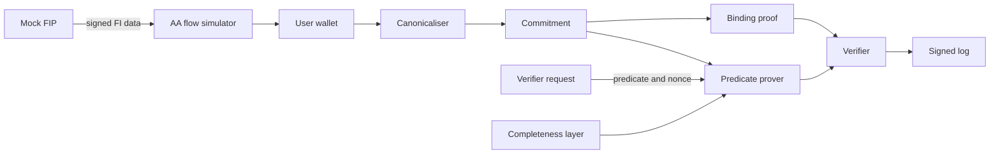
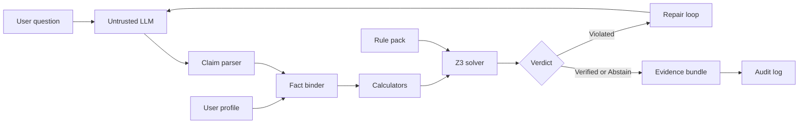
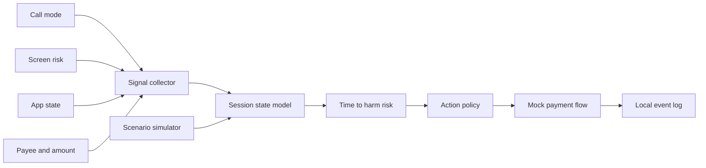
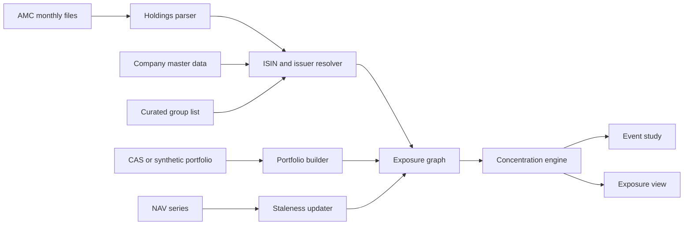
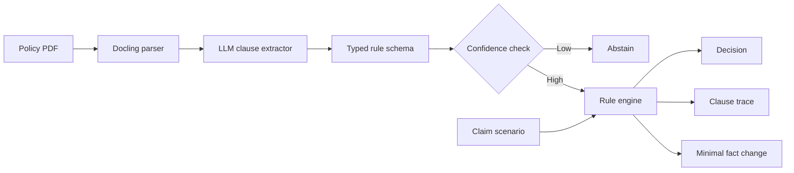

# Prove affordability without sharing bank statements

## 1. Executive recommendation: build consent-bound affordability proofs, with verified advice as the declared fallback

**Build a system that lets a person prove a financial predicate from Account Aggregator (AA) format data, such as "balance at least X" or "average monthly credits at least Y", without handing over the statement, and measure how far that proof can be defended against the cheating a valid signature cannot stop.** The project replaces "Stockify plus a chatbot" with a question that has a technical answer. India's consent framework delivers data to the lender. RBI bars use beyond the consent artefact ([RBI AA Master Direction, cl. 7.6.2](https://www.rbi.org.in/Scripts/BS_ViewMasDirections.aspx?id=10598)), but in the sources reached nothing technical verifies that after decryption. Consent filters select rows rather than answer a predicate, and no production use of `QUERY` mode was found ([AA consent object](https://docs.setu.co/data/account-aggregator/consent-object)). Lending rules require "need-based" collection ([Cyril Amarchand on the Digital Lending Directions](https://corporate.cyrilamarchandblogs.com/2025/05/fig-paper-no-44-series-3-rbi-consolidates-directions-on-digital-lending-implications-for-res-lsps/)), and no accepted technical test for that was found. This is the shortlisted idea closest to the Indian Patent Office's own language on cryptographic and privacy methods ([CRI Guidelines 2025](https://ipindia.gov.in/frontend/pdf/patents/guidelines/GUIDELINES%20FOR%20EXAMINATION%20OF%20COMPUTER%20RELATED%20INVENTIONS%20%28CRIs%29%20-%202025.pdf)). Its main results (proof time, memory, proof size, attack success) can be measured honestly without real bank data, and it needs no LLM quota and no investment-advice boundary.

**The choice is close, and we say so.** Under our weights this idea scores 7.29 against 7.10 for the runner-up, a solver-checked verifier for personalised financial advice. The winner changes in three of six alternate weight sets, and every one of those changes goes to the verifier. The tiebreak is the guide's own brief: if a potentially patentable technical innovation is a real requirement, the proofs win; if the guide waives it, the verifier wins. The proofs are also the most technically demanding idea on the shortlist. We chose them despite that, not because of it, and the complexity criterion carries only 3% of the weight.

**Three weaknesses should be read before deciding.** Problem significance and real-world applicability are the proofs' weakest scores, because lender acceptance is unknown and over-collection in AA lending is documented as commentary and not as a measurement ([EPW](https://www.epw.in/engage/article/merits-and-demerits-indias-account-aggregator)). The central premise is open: the research could not confirm that the signed plaintext reaches the customer (Section 6.1 reasons through the three possible outcomes). Close patents already exist, including a Microsoft patent with a bank-signed balance and lending example ([US12341895B2](https://patents.google.com/patent/US12341895B2/en)). None of this makes the idea patentable or not. It means the first month is a set of cheap tests, with a pre-declared switch to the verifier if they fail.

| Verify first | Why it decides the project | How | By | If it fails |
|---|---|---|---|---|
| Does the FIP signature cover plaintext, survive the AA hop, and reach the customer? | Decides whether a holder-side proof has a trust root today or needs a specification change | Read the [ReBIT API v2.0.0 specification](https://specifications.rebit.org.in/artefacts/NBFC-AA_API_Specification_v2.0.0.pdf), inspect [Setu sandbox](https://docs.setu.co/data/account-aggregator/quickstart) responses, write to Sahamati, ReBIT and Setu with these three questions | End of week 3 | Project continues on a mock FIP with a proposed minimal specification change, and the deployment claim is weakened. See Section 8 for the switch rule |
| Has anyone done zero-knowledge proofs over AA data? | The AA-specific searches did not run | Run the exact strings in Section 9 on InPASS, Patentscope, Espacenet, Google Scholar, arXiv, ePrint and GitHub | End of week 2 | A close hit lowers novelty and patent scores, and the scoring then favours the verifier (Section 7) |
| Can this team prove a signed threshold predicate on its own laptops? | Team skills were not assessed, and no cost figure exists for AA payload circuits | Noir and Circom spike: one RSA signature check plus one threshold, at 10 and 1,000 rows | End of week 4 | A feasibility score of 4 or lower hands the win to the verifier |
| Will the guide accept mock-FIP evaluation and patent preparation as the project's goals? | The whole case rests on the guide's third requirement | Show the guide Sections 1, 7 and 8 | Week 1 | If patentability is waived, build the verifier |
| Who owns the invention, and is college evaluation confidential? | A disclosure before filing can count against the team | Read the college IPR policy; ask for closed reviews under written confidentiality | Week 2 | File before the first review, or do not treat a patent as a goal |

Two unrelated dates also apply to the existing codebase. Stockify's model `gemini-2.5-flash` has an earliest shutdown of 1 December 2026 ([Gemini deprecations](https://aistudio.google.com/docs/deprecations)), and free-tier Gemini content is used to improve Google's products ([Gemini pricing](https://aistudio.google.com/docs/pricing)), so no real personal financial data should reach it. Section 10 gives the full checklist.

## 2. How to read this report: five evidence labels and a search that stopped early

| Label | Meaning | How to use it |
|---|---|---|
| **[Fact]** | Regulator text, statute, official statistic or specification, read directly by the research process | Quote after checking the linked text |
| **[Research]** | A paper or preprint finding, self-reported by its authors and not reproduced here. Most 2025-2026 items are arXiv preprints unless a venue is named | Cite as a finding, not as settled |
| **[Reported]** | Press, law-firm, vendor, self-reported or search-excerpt material, including what a product's own page says | Check the primary source before relying on it. A product page's silence does not prove a feature is absent |
| **[Proposal]** | Our own technical design or planning judgement | Argue with it |
| **[Hypothesis]** | An untested inference, an arithmetic reading of mixed sources, or a claim marked unverified in the research | Do not state as true until tested |

**Research limits.** The web search budget ran out partway through. **WIPO Patentscope returned HTTP 403, InPASS needs a CAPTCHA that was not attempted, and Google Scholar disallows automated queries, so none of the three was searched.** No IN-numbered patent application was opened. The only Indian-origin patent document seen is a Mastercard US patent with an Indian priority ([US12271352B2](https://patents.google.com/patent/US12271352B2/en)). Each patent mechanism received one or two queries through a general search tool, with no CPC or IPC classification search and no Espacenet or Lens, and applications filed in roughly the last 18 months are not yet published, so they cannot be seen. One query reached a Google Patents endpoint that robots.txt disallows. It was stopped once that was noticed, and its results were used only as leads. **"Not found" in this report means only "not found by this scan". It never means absent, and nothing here is called unsolved. The term used is "inadequately addressed".**

**What must be rerun by hand.** All twelve patent strings and the eight second-round strings in Section 9 must be run on InPASS, Patentscope and Espacenet, with CPC G06Q40 added. Beyond patents, these planned literature searches did not run and should be run in Google Scholar and arXiv: 2023-2026 risk-questionnaire validity; finfluencer and education circulars; the November 2025 IA and RA amendments; Indian factor-model data; RBI mis-selling rules; event-sequence credit models; household digital twins and microsimulation; hands-on checks of CRED, Fi, Jupiter, Paisabazaar, Moneyview and KreditBee; Indian-language scam benchmarks; behavioural biometrics; Indian-filing XBRL access; Indic deepfake datasets; Indian credit-report error surveys; DigiLocker and Aadhaar verifiable credentials; and Indian transaction-narration datasets. No university marking scheme could be retrieved, so the department's rubric overrides any assumption here. Scores, weights and rankings are our judgement, not measurements. This report is not legal advice.

## 3. Problem landscape: the largest harms and the most open technical problems are not the same

The evidence below separates what is harmful from what is technically open. Authorised scams have the largest documented harm but a crowded patent field. Selective disclosure has the thinnest harm evidence but the clearest technical gap. Every gap is "inadequately addressed, per the sources reached".

### 3.1 Investment and portfolio: retail losses are measured, concentration is not

**Retail derivatives losses.** [Fact] 87.7% of individual traders lost in FY26, 97% are predominantly options buyers, and among traders active throughout FY22-FY26, 65.6% lost every year and 0.5% profited every year. SEBI calls this descriptive, not causal ([SEBI behaviour study, Aug 2026](https://www.sebi.gov.in/sebi_data/attachdocs/aug-2026/1787233601328.pdf)). [Reported] FY26 losses were about ₹91,685 crore, with options at 92% of them ([Business Today](https://www.businesstoday.in/markets/story/rs91685-cr-lost-88-of-individual-traders-lost-money-in-fy26-options-drove-92-of-losses-550474-2026-08-21)). [Research] Higher lot sizes and margins moved traders into cheaper out-of-the-money options with bigger losses, and switching to a fintech broker is associated with 55% higher volume ([Agarwal et al.](https://www.aeaweb.org/conference/2026/program/paper/StD8aadb)). *Existing:* product-structure rules ([SEBI Jul 2025](https://www.sebi.gov.in/sebi_data/attachdocs/jul-2025/1751900271726.pdf)) and Zerodha's manual Kill Switch, with no loss-based trigger described ([Zerodha](https://support.zerodha.com/category/trading-and-markets/nudge/killswitch/articles/what-is-the-kill-switch)). Other brokers were not checked. *Gap:* no published effect size was found for any broker nudge. This is partly an incentive gap, and trader-level Indian data is private.

**Hidden concentration.** No regulator or academic measure of investor-level look-through concentration across Indian funds, ETFs, stocks, ESOPs, ULIPs and NPS was found, so **severity is not established**. [Reported] SEBI's February 2026 categorisation circular caps overlap at 50% only within one AMC ([RFMLR](https://www.rfmlr.com/post/calibrated-liberalisation-in-sebi-s-2026-mutual-fund-reforms)). [Research] The strongest Indian study covers direct stock holdings only, across almost 10 million accounts ([Balasubramaniam et al.](https://ideas.repec.org/p/nbr/nberwo/29065.html)). *Existing:* PhonePe documents direct-plus-fund overlap ([PhonePe](https://www.phonepeinvest.com/support/home/account-management/portfolio-analyser/how-does-the-app-check-if-my-portfolio-is-diversified)), MF Profiler includes debt instruments ([MF Profiler](https://www.mfprofiler.com/)), and Fi exposes ESOPs, loans and NPS as data with no analytics described ([Fi](https://fi.money/features/getting-started-with-fi-mcp)). *Gap:* no documentation reached describes roll-up across equity and debt to one issuer, promoter-group links, or joint modelling of employer income, ESOPs and loans.

**Stated risk versus actual exposure.** [Fact] Advisers profile clients on client-provided information ([SEBI IA FAQs](https://www.sebi.gov.in/sebi_data/faqfiles/aug-2025/1755174193178.pdf)). The riskometer scores schemes, and the method sections read have no issuer or group concentration term ([SEBI circular, Oct 2020](https://www.sebi.gov.in/sebi_data/attachdocs/oct-2020/1602580413614.pdf)). [Research] One stated risk item plus demographics explains about 14% of allocation variance in a US sample ([Grable and Chatterjee](https://www.financialplanningassociation.org/learning/publications/journal/JAN26-risk-tolerance-portfolio-choice-insights-targeted-high-income-sample-OPEN)). Against the easy assumption that revealed risk is truer, a 2020 study (excerpt only) found behavioural measures weaker on reliability and validity ([PMC7505965](https://www.ncbi.nlm.nih.gov/pmc/articles/PMC7505965/)). *Gap:* no Indian study comparing stated profile with holdings was found, and the search was cut short.

**Retail stress testing.** [Reported] Indian tools reached show backward-looking statistics and flags ([Morningstar India](https://morningstar.in/posts/64689/get-instant-x-ray-fund-holdings.aspx)), while Vanguard's scenario tool is adviser-facing ([Vanguard](https://advisors.vanguard.com/strategies/portfolio-strategies/portfolio-analysis/stress-testing)). [Research] Vine-copula reverse stress exists for a bank's currency book ([Zhou and Nolde](https://arxiv.org/abs/2404.00109)). *Gap:* propagating a scenario through month-old holdings, debt issuers and personal liabilities to one investor's outcome.

### 3.2 Personal finance, debt, lending and credit: stress is concentrated, not systemic

**Small-ticket stress.** [Fact] RBI reports improving borrower quality overall, yet fintechs hold 56.8% of personal loans under ₹50,000 with delinquencies of 6.4%, and about half of their unsecured borrowers are under 35 ([RBI FSR June 2026](https://www.rbi.org.in/Scripts/PublicationReportDetails.aspx?UrlPage=&ID=1324)). [Fact] Nearly three-fifths of personal loan customers in Q2 FY25 had more than three live loans at origination, and 11.0% of borrowers taking a personal loan under ₹50,000 already had an overdue personal loan ([RBI FSR Dec 2024](https://www.rbi.org.in/Scripts/PublicationReportDetails.aspx?UrlPage=&ID=1284)). [Fact] Loans under ₹1 lakh were 89.4% of personal loan originations by count in Q1 FY27 ([CRIF, Sept 2026](https://www.crifhighmark.com/media/7548/how-india-lends-september-2026.pdf)). A project should not claim a national debt crisis. "Concentrated, fast-moving, poorly observed" is defensible.

**Bureau lag.** [Reported] Reporting moved to weekly from 1 July 2026, with reference dates on the 9th, 16th, 23rd and last day and files within 4 days ([OneFin](https://www.onefin.in/post/rbi-s-credit-reporting-overhaul-what-the-weekly-mandate-means-for-nbfcs)). [Hypothesis] That leaves roughly 11-13 days before bureau processing, down from about 22. No data on actual compliance or disbursal-to-visibility time was found, and the Amendment Directions were not read. [Fact] Digital lending must be reported irrespective of tenor ([RBI Directions 2025, para 16](https://www.rbi.org.in/Scripts/NotificationUser.aspx?Id=12848)), so India's gap is timing and matching, unlike US pay-in-four loans, where stacking is "a particular blind spot" ([CFPB](https://files.consumerfinance.gov/f/documents/cfpb_BNPL_Report_2025_01.pdf)). No public figure for Indian stacking between refreshes was found.

**Affordability is a point estimate.** [Reported] FOIR is quoted at about 40-50% of net income on lender marketing pages, not in RBI rules ([Lendingkart](https://www.lendingkart.com/blog/what-is-foir/)). [Reported] FinBox computes income, obligations and a recommended EMI, with no forecasting described ([FinBox](https://finbox.in/blog/how-finbox-bankconnect-powers-advanced-income-analytics)). [Research] First-time Indian borrowers have higher income volatility than never-borrowers, and borrowing raises the level and volatility of consumption ([Palta, Sane and Thomas](https://papers.xkdr.org/papers/2025Paltaetal_newtocredit.pdf)). That paper's abstract and introduction differ on smoothing, so read it fully. *Existing:* Monte Carlo planners focused on market returns ([ProjectionLab](https://projectionlab.com/monte-carlo)) and an adjacent US patent ([US 11468384](https://image-ppubs.uspto.gov/dirsearch-public/print/downloadPdf/11468384)). *Gap:* a calibrated P(shortfall within H months | this decision, this household). **What Indian apps actually offer was not verified.**

**Early warning.** [Fact] RBI's early warning framework targets suspected fraud, with reporting at ₹3 crore and above, not retail borrower distress ([RBI Fraud Directions, 2024](https://www.rbi.org.in/Scripts/NotificationUser.aspx?Id=12702)). [Research] Default prediction is heavily studied ([Albanesi and Vamossy](https://arxiv.org/abs/1908.11498); [PDx](https://arxiv.org/abs/2512.22305)). Banks very likely run internal scorecards that are not public. *Gap:* lead time at a fixed alert budget, rollover chains, and whether alerts help. "Debt spiral" had no standard definition in anything read.

**Thin-file credit and rejection reasons.** [Reported] AA-enabled lending was about ₹3.82 lakh crore in FY26, 8.4% of retail and MSME lending by value, on the sector body's own estimates ([IANS](https://ianslive.in/indias-account-aggregator-ecosystem-drives-rs-382-lakh-crore-loans-in-fy26--20260827133606)). [Fact] Banks have had to give main rejection reasons in writing since 2007 ([RBI Fair Practices Code](https://rbi.org.in/commonman/english/scripts/Notification.aspx?Id=238)). [Research] On HELOC with logistic regression, 92.7% of LIME and 77.3% of SHAP explanations highlighted no responsive feature, and 22.2% of denied people could not be approved under any intervention, under that paper's assumptions ([Cheon et al.](https://arxiv.org/html/2410.22598)). Recourse can decay over time ([De Toni et al.](https://arxiv.org/html/2410.08007v3)) and across near-optimal models ([ElliCE](https://arxiv.org/abs/2602.07674)). *Gap:* these properties were not seen combined and tested on a time-stamped lending dataset, and Indian credit data with outcomes was not found. No official thin-file count was found, and OCEN status was not collected.

**Consumer protection and literacy.** [Fact] The Directions ban dark patterns on multi-lender pages and require a consistent approach for similar borrowers, and RBI does not verify app data reported on CIMS ([RBI Directions 2025, paras 6, 17](https://www.rbi.org.in/Scripts/NotificationUser.aspx?Id=12848)). [Reported] MeitY has blocked 87 illegal loan apps ([MediaNama](https://www.medianama.com/2025/12/223-meity-87-illegal-lending-apps-it-act/)). [Fact] 27% of Indians qualified as financially literate on 2018-19 fieldwork ([NCFE-FLIS 2019](https://ncfe.org.in/wp-content/uploads/2023/12/NCFE-2019_Final_Report.pdf)). Literacy is behavioural and needs field trials, so a chatbot does not address it on its own.

### 3.3 Payments and fraud: most reported loss sits outside what transaction models can see

**Authorised scams.** [Fact] Citizen-reported cyber-fraud rose from ₹551 crore (2021) to ₹22,848 crore (2024) and ₹22,495 crore (2025), across 24,02,579 complaints in 2025 ([PIB, MHA, Feb 2026](https://www.pib.gov.in/PressReleasePage.aspx?PRID=2226441&lang=1&reg=3)). [Reported] I4C's 2025 shares by loss are investment scams 77% and digital arrest 8% ([The420](https://the420.in/india-cyber-fraud-52976-crore-i4c-data-investment-scams/)). [Hypothesis] So about 85% of loss value may be victim-initiated, though no official authorised and unauthorised split for India was found. [Fact] Singapore's comparable figure is 81.8% of reported scams, counted by case and not value ([SPF](https://www.police.gov.sg/-/media/SPF/Advisories/Scams/Annual-Scam-and-Cybercrime-Brief-2025.pdf)). [Research] A genuine user on a genuine device will most likely pass, and a Pay.UK AI pilot caught 56% of APP scam transactions ([Kansas City Fed](https://www.kansascityfed.org/research/payments-system-research-briefings/combating-authorized-push-payment-scams-in-fast-payment-systems/)). *Existing:* NPCI monitoring and MuleHunter ([TaxGuru reproducing a Rajya Sabha reply](https://taxguru.in/rbi/government-deploys-ai-combat-digital-payment-frauds-finance-ministry.html)), and DoT's number-risk indicator ([DoT/PIB](https://www.dot.gov.in/static/uploads/2026/02/1994430b3740f7f61b7d7fd8b7f5120d.pdf)). No public accuracy data was found for any of them ([MediaNama RTI report](https://www.medianama.com/2025/12/223-rti-23-banks-mulehunter-mule-accounts/)). *Gap:* the missing signal is live coercion context, and identifier reputation decays as criminals rotate SIMs and mules.

**Session-level coverage.** [Reported] Google's on-device scam detection in India began on Pixel 9+, off by default, in Hindi and English, with Pixel's India share under 1% in 2024 ([TechCrunch](https://techcrunch.com/2025/11/20/google-steps-up-ai-scam-protection-in-india-but-gaps-remain)). [Reported] Android also ships in-call restrictions and banking screen-share warnings ([Google](https://blog.google/security/new-android-scam-protections/)). [Fact] An ordinary app cannot capture call audio ([Android](https://developer.android.com/media/platform/sharing-audio-input)). [Research] Real-time LLM precision on Chinese transcripts fell to about 0.70-0.77 from 0.95-1.00 retrospectively ([Shen et al.](https://arxiv.org/html/2502.03964)), and rewriting cut Korean classifier accuracy by up to 30.96% ([arXiv 2507.16291](https://arxiv.org/abs/2507.16291)). *Gap:* coverage by device, language, opt-in and OTT calling, and no public benchmark was found that fuses call state, screen capture, app state and payee risk across a session. An independent evaluation of Google's system was not found.

**Mule detection.** [Research] MEGA-GNN's best minority-class F1 on AMLworld's three low-illicit sets is 46.32, 49.40 and 38.31 even with complete synthetic labels ([MEGA-GNN](https://arxiv.org/pdf/2412.00241)). Rankings depend on the data: gradient boosting leads on Tide ([Tide](https://arxiv.org/abs/2603.01863)). *Existing:* federated and encrypted methods ([FHE AML](https://arxiv.org/abs/2411.02926)) and calibrated scores ([ProtoCP](https://arxiv.org/abs/2608.15768)). *Gap:* risk propagation across institution boundaries, a metric for money still recoverable, bounded-harm action choice, and redress. No data on wrongful freezes was found.

**Warnings and friction.** [Research] A US multi-agency review finds in-the-moment warnings often fail, with active and specific warnings doing better ([FTC-hosted review](https://consumer.ftc.gov/system/files/consumer_ftc_gov/pdf/A%20Review%20of%20Scam%20Prevention%20Messaging%20Research.pdf)). [Reported] RBI's April 2026 discussion paper proposes a one-hour hold above ₹10,000, with no final rules found ([Swarajya](https://swarajyamag.com/news-brief/rbi-proposes-one-hour-delay-on-digital-payments-above-rs-10000-to-curb-rising-fraud)). [Fact] Singapore issued 12 Restriction Orders to victims who kept believing scammers after police contact ([SPF](https://www.police.gov.sg/-/media/SPF/Advisories/Scams/Annual-Scam-and-Cybercrime-Brief-2025.pdf)). *Gap:* no randomised evidence on coerced victims in real payment flows was found.

**Account takeover and deepfake KYC.** [Fact] RBI's authentication directions require two distinct factors and allow behaviour and device checks ([RBI](https://www.rbi.org.in/Scripts/NotificationUser.aspx?Id=12898)). These prove the holder is genuine, not that the holder is free of manipulation. Deepfake and injection figures for India are vendor-sourced and are leads only. Behavioural biometrics received no dedicated search.

### 3.4 AI reliability and misinformation: the failure has moved to "wrong for this person"

**Accuracy.** [Research] Top scores remain 64.37% on agentic analyst work ([Vals Finance Agent v1.1](https://www.vals.ai/benchmarks/finance_agent)) and 67.17 on stepwise reasoning ([FinChain](https://arxiv.org/html/2506.02515v3)). The 4.4% error for Claude Sonnet 4 on masked spans is a floor, since the benchmark filters for answerability ([FAITH](https://arxiv.org/html/2508.05201)). LLM judges also let numeric errors through ([VeriFin](https://arxiv.org/abs/2608.10213)). [Research] Hallucination in one single-company Indian benchmark ranged from 11-31% of responses across six languages, with no peer review found ([FABRIC](https://huggingface.co/datasets/agenticclass/fabric/blob/main/README.md)).

**Suitability.** [Research] Self-reported risk tolerance carried 57-88% of surrogate predictive weight across most GPT models tested on 1,000 synthetic clients ([Ross and Lo](https://arxiv.org/abs/2604.23837)). Contrary evidence exists: GPT-4 was reported to reflect tolerance, capacity and preference ([Fieberg et al.](https://www.cesifo.org/DocDL/cesifo1_wp10529.pdf)). No suitability test with Indian household profiles was found.

**Verification.** [Research] VeriFin returned zero observed false accepts in 18 settings on US filings, with coverage of 49.3-82.1% on FinanceBench and heavy dependence on a hand-curated registry. [Fact] AWS Automated Reasoning checks are English (US) only and detect-only ([AWS docs](https://docs.aws.amazon.com/bedrock/latest/userguide/guardrails-automated-reasoning-checks.html)). [Research] The underlying paper reports 99.2% soundness at 15.6% recall, and no finance-specific policy was evaluated ([Bayless et al.](https://arxiv.org/html/2511.09008v1)). *Gap:* solver checks of advice against a user's own data, third-party recheckable proof objects, and Indian rule packs were not found in one targeted search. **A verifier proves consistency with a stated rule set. It does not prove that advice is good.**

**Multi-agent claims.** [Research] Under bias-controlled testing, FinMem's TSLA Sharpe falls from 2.679 to 0.641 with no significant alpha ([FINSABER](https://arxiv.org/html/2505.07078v3)), and TradingAgents nets +2.3% against buy-and-hold +4.8% ([Alpha Illusion](https://arxiv.org/html/2605.16895v1)). Another trading agent would be a poor project.

**Misleading finance content.** [Reported] SEBI says more than 1.2 lakh posts were removed and that its in-house Sudarshan tool tracks content across languages, with no public accuracy figures ([Tribune/ANI](https://www.tribuneindia.com/news/business/sebi-removes-1-2-lakh-misleading-finfluencer-posts-deploys-ai-sudarshan-chairman/)). The Sathe and 82-SME-stock matters are interim orders and allegations, under challenge in the first case ([LiveLaw](https://www.livelaw.in/amp/corporate-law/sebi-cracks-down-on-finfluencer-avadhut-sathe-impounds-546-crore-for-providing-unregistered-investment-advice-312335); [Free Press Journal](https://www.freepressjournal.in/amp/business/sebi-bans-7-individuals-in-20-crore-stock-manipulation-case-linked-to-social-media-pump-and-dump-scheme)). [Research] Public datasets cover crypto pumps ([PumpSense](https://arxiv.org/abs/2605.09431)), English numeric claims ([NumClaim](https://arxiv.org/html/2402.11728)) and political Hinglish claims ([HiFACTMix](https://arxiv.org/abs/2508.10001v1)). *Gap:* no public Hinglish financial-claim dataset and no message-level Indian equity pump dataset was found. [Research] Open-source deepfake detectors lose about 45-50% of AUC on in-the-wild media ([Deepfake-Eval-2024](https://arxiv.org/html/2503.02857v4)).

**Governance direction.** [Fact] RBI's FREE-AI report is a set of recommendations, 20.80% of 612 surveyed entities use or develop AI, and it calls privacy technologies "nascent" ([RBI FREE-AI](https://www.rbi.org.in/Scripts/PublicationReportDetails.aspx?UrlPage=&ID=1306)). [Reported] SEBI's chairman said in August 2026 that tiered guidelines would require kill-switch and human-in-the-loop controls ([Outlook Money](https://www.outlookmoney.com/invest/sebi-to-issue-aiml-guidelines-for-capital-markets-mandatory-kill-switch-and-human-oversight-framework-explained)). Explainability alone is crowded ([Disagreement Problem](https://arxiv.org/abs/2202.01602)), so it is a weak novelty choice unless tied to something else.

### 3.5 Data and privacy: AA adoption is public, but quality and post-delivery use are not

**Adoption and quality.** [Fact] At 31 March 2026 there were 179 FIPs, 989 FIUs and 284.6 million linked accounts ([DFS](https://financialservices.gov.in/account-aggregator-framework)). [Reported] One vendor's platform shows 45.4% of consents approved and 75.9% of fetches successful, with failure causes not stated ([SMEStreet on Finarkein](https://smestreet.in/infocus/finarkein-report-highlights-next-phase-of-indias-account-aggregator-ecosystem-12519273)). [Fact] API health dashboards are restricted to members ([Saans](https://sahamati.org.in/saans-api-health-dashboard/)), while the UK publishes equivalents ([Open Banking UK](https://www.openbanking.org.uk/api-performance/)). [Fact] ReBIT had to state that mandatory fields must not carry null or dummy values ([ReBIT circular](https://sahamati.org.in/wp-content/uploads/2025/10/3Clarification_on_Mandatory_and_Optional_fields_V1.0.pdf)). *Gap:* no public per-FIP measure of content quality was found.

**Consent granularity and what happens after delivery.** [Fact] There are five purpose codes and none names lending ([Sahamati](https://sahamati.org.in/purpose-codes/)). Data may not be used beyond the consent artefact ([RBI Master Direction, cl. 7.6.2](https://www.rbi.org.in/Scripts/BS_ViewMasDirections.aspx?id=10598)). [Reported] Commentators warn of over-collection and consent fatigue as analytical concerns, not documented misuse ([EPW](https://www.epw.in/engage/article/merits-and-demerits-indias-account-aggregator)). [Hypothesis] About 13 data deliveries per fulfilled consent in September 2026 hints at monitoring use ([Sahamati dashboard](https://sahamati.org.in/aa-dashboard/)). *Gap:* nothing technical verifies `dataLife` or purpose after the FIU decrypts, and no audit of FIU retention was found.

**Selective disclosure.** [Fact] FIPs must digitally sign data before sending it to the AA (cl. 7.3), and the fetch response carries `encryptedFI`, with a detached JWS on the body ([AA standards repo](https://github.com/Sahamati/account-aggregator-standards)). [Research] GovBind proves statements over Turkish e-Devlet PDFs in 54-119 s end to end ([GovBind](https://eprint.iacr.org/2026/2206)). [Reported] zkPDF was archived in August 2026 ([zkPDF](https://github.com/privacy-ethereum/zkpdf)). *Gap:* one extended search for AA plus zero knowledge found nothing AA-specific, which is weak evidence. **For ratios, the gap is completeness and semantics rather than cryptography**, because income and EMI are not signed fields and the prover chooses which accounts to include.

**Privacy technology claims.** [Fact] BIS Hertha used synthetic data throughout ([BIS](https://www.bis.org/about/bisih/topics/fmis/hertha.htm)). [Research] Strong differential privacy costs real utility on public tables ([Zuo et al.](https://arxiv.org/abs/2602.09288)), and a sub-$1,000 bus interposer breaks SGX, TDX and SEV-SNP attestation ([TEE.fail](https://tee.fail/)). [Reported] iSPIRT's clean room is work in progress ([depa-training](https://github.com/iSPIRT/depa-training)). No audited production result was found.

**Record inconsistency.** [Reported] Ombudsman complaints against credit bureaus rose from 1,039 (FY23) to 4,585 (FY25) ([KNN India](https://knnindia.co.in/news/newsdetails/sectors/rbi-ombudsman-complaints-jump-1355-in-fy25-cic-grievances-hit-3-year-high-rbi-report)). That is a floor on visible disputes, not an error rate. No official Indian error prevalence was found. [Reported] Corrections must be made at source ([RBI CIC Directions as reproduced](https://taxguru.in/rbi/rbi-credit-information-companies-directions-2025.html)). *Gap:* event-level matching across bureau, bank, CAS and AIS has no public benchmark found. Commercial tax tools were not evaluated.

**Blockchain.** [Reported] Atomic bond settlement against wholesale CBDC has been piloted, with no cost comparison found ([The Crypto Basic](https://thecryptobasic.com/2026/09/11/india-launches-107-million-tokenised-bond-pilot-linked-to-rbi-wholesale-cbdc/)). [Proposal] For consent logs, credentials and income proofs, a signed append-only log is simpler, and putting personal data on a ledger conflicts with erasure duties. One student project's contract exposes the earnings it claims to hide ([Acre](https://github.com/SomehowLiving/Acre)). None of our ideas uses a blockchain, for this reason.

**DPDP.** [Reported, law-firm summaries] Consent-manager rules begin about 13 November 2026 and core fiduciary duties about 13 May 2027, with logs kept at least a year ([SS Rana](https://ssrana.in/articles/meity-notifies-final-digital-personal-data-protection-rules-2025/)). The Gazette text was not read.

### 3.6 Emerging areas: insurance and complaint routing have the strongest official numbers

**Insurance clause comprehension.** [Fact] 59% of entertainable life complaints disposed in FY24 fell under Rule 13(1)(d), misrepresentation of policy terms ([CIO Annual Report 2023-24](https://cioins.co.in/annualreports/AnnualReport2023-2024.pdf)). This is a complaint category at the ombudsman, not a finding about each policy. [Reported] Bima Bharosa recorded 2,57,790 grievances in 2024-25 ([Outlook Money](https://www.outlookmoney.com/insurance/insurance-claims-mis-selling-account-for-most-insurance-complaints-in-fy25-reveals-irdai-annual-report)). *Existing:* Ditto's plain-English explainer ([Ditto](https://joinditto.in/)) and paid complaint handling ([Insurance Samadhan](https://www.insurancesamadhan.com/)). *Gap:* no product seen derives a checkable coverage decision with a clause-level trace. Note the mismatch: the 59% is life-sector, while health complaints are reported as about 95% claim repudiation (excerpt only). A health-policy tool answers the repudiation evidence, not the 59%.

**Complaint routing.** [Fact] Of 7,84,176 closures at RBI's central receipt centre, 47.34% were First Resort and 27.57% were addressed to other authorities ([RBI Ombudsman Report 2024-25](https://rbi.org.in/scripts/PublicationsView.aspx?id=23441)). *Gap:* many complaints look misdirected or premature, but no public complaint text was found, and nothing shows users would adopt a filing assistant.

**Tax and retirement.** [Reported] The Income Tax Act 2025 applies from 1 April 2026 ([JM Financial, a single broker blog](https://www.jmfinancialservices.in/blogs-and-articles/new-income-tax-rules-from-april-1-2026)). [Fact] India scores 46.8, grade D, on the 2026 Mercer index ([Mercer](https://www.mercer.com/globalpensionindex)). Indian lot-level tax products were not surveyed.

**Gig income and voice.** [Reported] NITI estimated 7.7 million gig workers and projected 23.5 million by 2029-30, excerpt only ([IndBiz](https://indbiz.gov.in/indias-gig-economy-to-have-23-5-million-workers-by-2029-30-niti-aayog/)). Voice-banking evidence is company claims ([ThePrint](https://theprint.in/ground-reports/voice-based-banking-for-low-literate-indians/2610584)). No gig cash-flow data was found.

**MSME credit and GST fraud.** [Reported] Detected fake ITC was ₹58,772 crore in FY25 ([Business Today](https://www.businesstoday.in/india/story/shell-firms-circular-trading-fake-gst-invoice-frauds-continue-despite-safeguards-515130-2026-02-08)). [Fact] GSTN already runs analytics on data under NDA ([GST Hackathon](https://event.data.gov.in/event/gst-analytics-hackathon/)), so students would be testing their own generator.

**ESG labels.** [Reported] SEBI rules reportedly require 80% alignment and monthly scores, excerpt only ([fintech.global](https://fintech.global/2023/07/24/sebi-unveils-robust-disclosure-rules-to-boost-green-financing-in-india/)). [Reported] Monthly holdings are public at least for PPFAS ([PPFAS](https://amc.ppfas.com/downloads/portfolio-disclosure/)). One search found no holdings-versus-label study, which is weak evidence.

### 3.7 Corrections register: figures not to repeat without the caveat

| Item | What circulates | What the research found | Treatment |
|---|---|---|---|
| Small-loan delinquency | 8.2% ([Deccan Chronicle](https://www.deccanchronicle.com/amp/business/rbi-flags-risks-as-share-of-borrowers-availing-multiple-loans-rise-1850782)) | In the FSR text read, 8.2% appeared only as a GDP figure | Do not use |
| India BNPL delinquency | 8.4% on a web page | Unverified attribution | Do not use |
| "3+ or 4+ lenders" | Quoted as retail borrowers | Both figures refer to microfinance ([FSR June 2026](https://www.rbi.org.in/Scripts/PublicationReportDetails.aspx?UrlPage=&ID=1324)) | Label as microfinance |
| Household debt | 47.8% of GDP ([Deccan Herald](https://www.deccanherald.com/amp/story/opinion/the-limits-of-borrowed-growth-4082266)) | RBI gives 45.5% at Sept 2025 and 41.3% at March 2025. A 4.2-point rise in six months may reflect a revised series | Use RBI, and do not call it six-month growth without checking |
| Gold loans | ₹21.7 lakh crore vs ₹5.14 lakh crore | Different scopes ([CRIF](https://www.crifhighmark.com/media/7548/how-india-lends-september-2026.pdf); [Policy Circle](https://www.policycircle.org/economy/rbi-financial-stability-report-loans/)) | State the scope |
| Credit card complaints | "20.04% share" ([Bank Exams Today](https://currentaffairs.bankexamstoday.com/2025/12/rbi-ombudsman-report-202425-complaints.html)) | RBI's 20.04% is a growth rate. The share is 17.16% against banks ([RBI](https://rbi.org.in/scripts/PublicationsView.aspx?id=23441)) | Cite as growth |
| FY26 trader count | 78.6 vs 87.5 lakh | 78.60 lakh is the 15-broker sample and 87.71 lakh the estimated total, per SEBI Table 1. Rupee aggregates appear to be on the sample | State the base |
| FY25 loss | ₹1,05,603 vs ₹1,11,788 crore | 13-broker vs 15-broker samples | State the base |
| FY26 options-trader loss share | 91.0% vs 87.7%; futures 68.4% vs about 66% | Unsettled, as the SEBI profitability PDF was not reached | Check the PDF |
| Falling loss-maker share | Read as regulation working | SEBI disclaims causality, and average loss per trader rose | No causal claim |
| 2025 cyber-fraud total | ₹22,495, ₹22,930, ₹19,812 or "over ₹32,600" crore | Different bases, and the last has no stated period ([The Quint](https://www.thequint.com/news/webqoof/wef-cybersecurity-report-flags-cyber-fraud-as-pervasive-threat)) | Use ₹22,495 crore (PIB) and do not mix |
| Multi-year fraud totals | ₹52,976, ₹55,050, ₹55,659 crore | Different periods ([Outlook Money](https://www.outlookmoney.com/news/pib-fact-check-flags-fake-ai-video-of-nirmala-sitharaman-promoting-investment-scheme)) | Do not add or compare directly |
| Digital arrest | 8% of 2025 losses vs ₹1,211 crore | 8% implies about ₹1,585-1,800 crore, so the series differ ([NewsMobile](https://www.newsmobile.in/fraud-and-scam/digital-arrest-scams-cost-indians-over-%E2%82%B93000-crore-supreme-court-questions-banks-role/)) | Cite separately |
| Bank-reported digital fraud | FY26's 293 cases as "fraud fell" | Narrower reporting and a ₹1 lakh threshold are stronger explanations ([ThePrint](https://theprint.in/india/banks-reported-rs-4457-cr-worth-of-digital-payment-fraud-over-11-yrs-close-to-half-of-it-was-in-2023-24/3004402/)) | Not evidence of decline |
| Money "saved" | ₹8,189 crore | The same figure is "saved" in one reply and "marked as Lien" in another ([PIB, July 2026](https://www.pib.gov.in/PressReleasePage.aspx?PRID=2287039&reg=3&lang=1)) | A lien is not a refund |
| UPI verified names | 30 June 2025 vs 1 June 2026 | Date conflict ([Angel One](https://www.angelone.in/news/economy/upi-appsto-to-show-only-real-beneficiary-names-from-june-30-2025); [Sansa Legal](https://www.sansalegal.com/post/upi-verified-name-display-rule-what-changed-for-digital-payments-from-june-1)) | Check NPCI |
| Monthly overlap disclosure | August vs 1 April 2026 | Not pinned, primary circular not reached ([Belong](https://getbelong.com/blog/mutual-fund-portfolio-overlap/)) | Read the circular |
| SEBI AI/ML guidelines | "Circular issued August 2026" ([Zytra](https://zytratechnologies.com/solutions-sebi.html)) | The chairman spoke of them as forthcoming on 19 August 2026 | Treat as not issued until located |
| PortBench | 90% fail to beat equal weight ([RePEc listing](https://ideas.repec.org/p/arx/papers/2605.27887.html)) | The v6 abstract reports beating equal weight on Sharpe in 54.2% of 120 evaluations ([PortBench](https://arxiv.org/abs/2605.27887)) | Use v6 |
| FAMMA o1 LivePro | About 60% vs 51.4% | The paper's own figures disagree ([FAMMA](https://arxiv.org/html/2410.04526)) | Check the table |
| Vals Finance Agent v2 | 65.4%, 60.60% or about 52% | Excerpts conflict and no Vals v2 page loaded ([BenchLM](https://www.benchlm.ai/benchmarks/financeAgentV2)) | Use v1.1 only |
| AWS "up to 99%" | Quoted alone | The paper's 99.2% soundness comes with 15.6% recall, and may not be the same metric | Always give recall |
| ULI scale | 64 lenders and 136 services vs 136 lenders and 64 providers | Growth or an error ([MediaNama](https://www.medianama.com/2026/01/223-unified-lending-interface-64-lenders-136-data-services/); [Unpay](https://www.unpay.co/blog/unified-lending-interface-uli-explained)) | Check RBIH |
| AA mock data | "All 23 FI types" | Setu's quickstart says 23 and its FI page says 9 ([Setu](https://docs.setu.co/data/account-aggregator/fi-data-types)) | Test in the sandbox |
| AA failure vs UK | 24.1% vs 0.48% | End-to-end fetches vs single API calls | Compare transparency only |
| Ombudsman health outcome | "Fell from 55% to 41%" ([Cafemutual](https://cafemutual.com/news/industry/36635-41-of-health-insurance-complaints-were-resolved-in-favour-of-policyholders-in-fy25)) | Looks like a denominator effect, as the same counts give 53.6% of disposals | Do not repeat |
| FY24 health complaints | 34,203 vs 31,490 | Unresolved. Check Statement H7 in the CIO report | Check |
| Mercer 2025 rank | 45th of 47 vs 52nd of 52 | Conflict | Cite the score |
| Removed loan-app counts | "47", "4,700+", "2,200+" removed | Blogs with no primary source | Use 87 (MediaNama) |
| FREE-AI survey | Unverified in some summaries | The RBI page was read directly in the privacy research: 127 of 612 | Use RBI |
| EU credit-scoring date | August 2026 in several papers | Annex III obligations now apply from 2 Dec 2027 ([AI Act Explorer](https://artificialintelligenceact.eu/ai-act-explorer/digital-omnibus/)) | Use the amended date |

## 4. Fifteen different project ideas, assessed independently of Stockify

Each idea below is a [Proposal] unless a sentence carries another label. Novelty always means "not found by this scan". The "Patent" paragraph uses one of three categories: product idea, technical improvement, or potentially patentable invention (candidate only). The filter for the third is strict: a technical problem independent of user preference, specific technical means in the claim, a measured effect beyond ordinary computing, a stated difference from the closest documents, and enough detail to reproduce it. No idea has been assessed by a patent agent. The common team stack is Next.js 15, TypeScript, PostgreSQL and Prisma for the interface, with Python and FastAPI for computation. Local Ollama models serve as the LLM fallback wherever an LLM appears.

### Idea 1. Consent-bound affordability proofs over AA data

**A. Problem.** A lender or landlord needs an answer ("balance at least X") but receives a whole statement. Borrowers bear the exposure, and data fiduciaries bear retention duties. It matters because lending rules demand need-based collection, and DPDP duties begin about May 2027. Platforms fall short because the AA framework was built to deliver data: AAs are data-blind, consent managers "cannot read the content" ([Ikigai on the DPDP Rules](https://www.legal500.com/intelligence/india/privacy/a-closer-look-at-the-dpdp-rules-2025)), and `dataFilter` selects rows only. zkTLS routes depend on login-style access, and Reclaim itself flags bank terms risk ([Reclaim](https://blog.reclaimprotocol.org/posts/legal-considerations)). Status: inadequately addressed, with a real technical gap and thin harm evidence.

**B. Solution.** The user fetches AA-format data into a local wallet, which commits to it once. A verifier sends a predicate and nonce, the wallet returns a proof bound to the consent ID, and the verifier sees only true or false. Modules: mock FIP, persona generator, witness builder, circuits, completeness layer, verifier portal, signed log. It differs by replacing data transfer with a checkable answer. Outcome: measured proof costs, a documented answer on the signature path, and measured attack rates.

**C. Technical innovation.** Zero-knowledge proofs are appropriate because the holder must convince a party who should not see the data. They address the limit that a signature proves origin but discloses everything. A TEE would add a hardware trust assumption ([TEE.fail](https://tee.fail/)), and a chain adds nothing a verifier key does not provide. New, on this scan: a ReBIT-schema witness format, a binding analysis, and a measured threat model for derived ratios. Demonstrate with live proof, tamper rejection, replay rejection and the marginal cost of a second predicate.

**D. Patent.** Mechanism: a holder-side proof over consent-bound, schema-canonicalised financial data, with commit-once and cheap repeated predicates plus a completeness attestation. Overlap: [Microsoft US12341895B2](https://patents.google.com/patent/US12341895B2/en), [DECO US11997107B2](https://patents.google.com/patent/US11997107B2/en), [Philips US11658827B2](https://patents.google.com/patent/US11658827B2/en) and [BLS-MT-ZKP](https://arxiv.org/abs/2402.15447). Could distinguish: AA consent binding, schema-aware commitment and completeness defence. Must demonstrate: cost at stated row counts and attack reduction against a baseline. *Novelty:* the AA layer is unsearched, so open. *Inventive step:* contestable, since an examiner could combine Microsoft and Philips with a statement format. *Industrial applicability:* plausible for pre-qualification, and lender acceptance is unknown. **Category: potentially patentable invention (candidate). Moderately covered.**

**E. Feasibility.**

| Stack | Models and tools | APIs and data | Paid needs | Free prototype | Difficulty | 8-month scope |
|---|---|---|---|---|---|---|
| Noir (MIT/Apache) or Circom, TypeScript, Next.js verifier, Node mock FIP, Postgres log | No ML core. Optional plaintext classifier for salary and EMI | Public XSDs, [rahasya](https://github.com/Sahamati/rahasya), Setu sandbox, synthetic ledgers | None. Circom's GPL matters only if distributed | Yes | High | Balance and average-credit predicates at scale; ratio with named defences, partly in the circuit |

*Validity limit:* results are on a mock FIP. They say nothing about real FIP behaviour.

### Idea 2. Solver-verified personalised advice

**A. Problem.** LLM advice can be numerically right and wrong for the person. People asking finance questions and any firm deploying an assistant are exposed, and SEBI's direction keeps responsibility with the deployer. Platforms check filings or institution policies. VeriFin addresses US filings, Bedrock checks policies, and no system checking advice against a person's own balance sheet was found in one targeted search. Status: inadequately addressed, and fast-moving.

**B. Solution.** An LLM drafts an answer, a parser extracts typed claims, deterministic calculators compute EMI and XIRR, and Z3 checks claims against the profile and a versioned rule pack. The system returns Verified, Violated or Abstain with the violated rules and a repair loop. Modules: claim parser, calculators, rule pack, solver, repair loop, evidence bundle, metamorphic auditor. It differs by treating the LLM as untrusted. Outcome: published false-accept, coverage and repair figures.

**C. Technical innovation.** An SMT solver fits because arithmetic and rule constraints have definite answers. It addresses LLM judges accepting wrong numbers. Exponents and root-finding are hard for solvers, so calculators compute them first and pass linear facts on. New, on this scan: per-user grounding, a recheckable bundle and Indian rule packs. Demonstrate with seeded errors caught live, and a third party rechecking a bundle offline.

**D. Patent.** Mechanism: typed claim extraction bound to user facts, solver verdict and a recheckable certificate. Overlap: [Intuit US11875123B1](https://patents.google.com/patent/US11875123B1/en), [Citibank US12147513B1](https://patents.google.com/patent/US12147513B1/en), [AWS checks](https://docs.aws.amazon.com/bedrock/latest/userguide/guardrails-automated-reasoning-checks.html), [VeriFin](https://arxiv.org/abs/2608.10213) and [BiasMix-Finance](https://arxiv.org/abs/2608.28646). Could distinguish: a specific certificate or extraction method with measured effect. Must demonstrate: false accepts, coverage and recheck time against an LLM judge. *Novelty:* the exact combination was not found, and dedicated queries did not run. *Inventive step:* weak against an AWS-VeriFin-BiasMix combination. *Industrial applicability:* plausible for regulated deployers. Table 2 of the Guidelines lists "a basic expert system for legal advice using if-then rules" as tending to be excluded. **Category: technical improvement, with a narrow candidate only in the certificate. Moderately covered, fast-moving.**

**E. Feasibility.**

| Stack | Models and tools | APIs and data | Paid needs | Free prototype | Difficulty | 8-month scope |
|---|---|---|---|---|---|---|
| Python, FastAPI, Z3, Next.js, Postgres append-only log | Gemini free tier on synthetic data only, Ollama fallback | 1,000 synthetic Indian profiles, seeded fault corpus, [FABRIC](https://huggingface.co/datasets/agenticclass/fabric), [IndiaFinBench](https://github.com/Rajveer-code/IndiaFinBench) | Small API budget possibly. A qualified adviser for labels | Yes | Medium | Full |

### Idea 3. Metadata-first coercion-session risk engine with a safe testbed

**A. Problem.** A coerced person passes every authentication check, so the transaction shows little. Victims of investment and digital-arrest scams are the group affected, and older adults report large losses ([New Kerala, excerpt](https://www.newkerala.com/news/a/over-lakh-senior-citizens-463-lakh-women-lodged-614.htm)). Platforms attach risk to identifiers or act on one signal, and Google's analysis is limited by device, language and opt-in. Status: inadequately addressed, the strongest fraud gap, and an improvement on a fast-moving OS baseline.

**B. Solution.** A mock banking app holds an on-device state model over a payment session, using call mode, unknown caller, screen-capture risk, app switching, new payee and amount against the user's history. It outputs time-to-harm risk and a graded action. A randomised testbed compares warning, delay, trusted-contact and hang-up-first interventions. Modules: signal collector, state model, policy, mock bank, scenario simulator, tactic corpus. It differs by using no call audio and no system privilege. Outcome: lead time at a fixed false-alarm budget and degradation under missing signals.

**C. Technical innovation.** Survival-style forecasting fits because the question is when harm arrives, and work such as [Vishing-Tactics-Bench](https://arxiv.org/abs/2609.07151) applies it to transcripts rather than sessions. It addresses the limit that third-party apps cannot hear calls. New, on this scan: session-level modelling that degrades gracefully. Demonstrate live on a low-cost phone with simulated money.

**D. Patent.** Mechanism: on-device fusion of session metadata into a time-to-harm estimate, with defined behaviour when signals are missing. Proposed novelty: no call audio and no system privilege. Overlap is heavy: [IBM US10810510B2](https://patents.google.com/patent/US10810510B2/en), [JPMorgan US20220232036A1](https://patents.google.com/patent/US20220232036A1/en), [JPMorgan US20250086656A1](https://patents.google.com/patent/US20250086656A1/en), [Capital One US11463574B1](https://patents.google.com/patent/US11463574B1/en), [Scamnetic US12626261B2](https://patents.google.com/patent/US12626261B2/en), [Microsoft US20170142252A1](https://patents.google.com/patent/US20170142252A1/en) and the [Android pilot](https://blog.google/security/whats-new-in-android-security-privacy-2025/). Could distinguish: a defined fusion design with measured latency and privacy behaviour under missing signals. Must demonstrate: lead time, latency, memory and false alarms against a named baseline. *Novelty:* four-signal fusion was not found in one document, but the screen-share query did not run. *Inventive step:* high risk of a combination objection. *Industrial applicability:* clear. Comviva and Microsoft (2023) help on security framing, while Blackberry (2026) "user-dependent problem" could be raised. **Category: technical improvement. CROWDED.**

**E. Feasibility.**

| Stack | Models and tools | APIs and data | Paid needs | Free prototype | Difficulty | 8-month scope |
|---|---|---|---|---|---|---|
| Kotlin, Android, on-device TFLite or ONNX, Python training, FastAPI, SQLite on device | Discrete-time survival model, gradient boosting baseline | Android APIs, [App Access Risk](https://developer.android.com/security/fraud-prevention/environment), self-built simulator, [BothBosu](https://huggingface.co/datasets/BothBosu/scam-dialogue) and [Hinglish seed](https://huggingface.co/datasets/Yash1072006/hinglish-scam-text-dataset) | Test phones | Yes | High | Engine and simulator. The human study only if ethics approval arrives early |

*Validity limit:* simulated detection rates are not real-world rates. Results prove the mechanism on open signals, and a simulation cannot reproduce real coercion. Tactics stay abstract, with no operational scripts published.

### Idea 4. Issuer- and group-aware exposure graph with uncertainty

**A. Problem.** Pairwise overlap answers "are these funds similar?", not "what does my money depend on?". Retail investors holding several funds and direct stocks are affected, and plausibly salaried investors whose employer, ESOPs and funds load on one sector, though prevalence is unmeasured. Tools stop at stock overlap, and SEBI's cap applies within one AMC. Status: part served and part inadequately addressed, with severity unestablished.

**B. Solution.** Upload a portfolio or CAS. The system resolves ISINs to issuers and groups, merges equity, debt and direct holdings, models month-old holdings as a distribution, and reports concentration with bounds. Modules: holdings parser, entity resolver, group linker, uncertainty updater, concentration engine, event-study harness. It differs by going beyond ISIN overlap. Outcome: a pre-registered test of whether group-adjusted scores explain stress-window drawdowns beyond stock-level HHI.

**C. Technical innovation.** Entity resolution and a graph fit because the difficulty is in links rather than arithmetic. [CorpFam](https://arxiv.org/abs/2609.04269) reports matchers recover only 4.2% of corporate-family pairs with no shared name, which points to the hard part. New, on this scan: equity-plus-debt-plus-group roll-up with uncertainty for one retail portfolio. Demonstrate with a real-scheme portfolio showing an exposure stock overlap misses, without naming any issuer as risky.

**D. Patent.** Mechanism: resolving holdings across equity and debt to issuer and group nodes, with a distribution over stale weights. Proposed novelty: that joint roll-up for one retail portfolio. Overlap: [BlackRock US20050267835A1](https://patents.google.com/patent/US20050267835/en), [Schwab US7599869B2](https://patents.google.com/patent/US7599869/en), [Vanguard US10043216B2](https://patents.google.com/patent/US10043216B2/en), [Locus US9245299B2](https://patents.google.com/patent/US9245299/en). Could distinguish: a specific candidate-generation method for family links. Must demonstrate: link-recovery gain over name matching, especially for pairs with no shared name. *Novelty:* the retail combination was not found on one query. *Inventive step:* uncertain. *Industrial applicability:* clear, though exposure calculation reads as financial analysis. **Category: product idea and technical improvement. Moderately covered.**

**E. Feasibility.**

| Stack | Models and tools | APIs and data | Paid needs | Free prototype | Difficulty | 8-month scope |
|---|---|---|---|---|---|---|
| Python, pandas, NetworkX, FastAPI, Next.js, Postgres, [casparser](https://github.com/codereverser/casparser) | Bayesian updating from returns, simple entity matcher | AMC monthly files, [AMFI NAV](https://portal.amfiindia.com/spages/NAVAll.txt), [Company Master Data](https://www.data.gov.in/catalog/company-master-data) (Open Data licence) | None | Yes | Medium | Full if group mapping stays hand-curated for a defined list |

*Kill test:* if group-adjusted scores add nothing over HHI in pre-registered windows, the novelty claim fails. A shareholding-data route is unverified.

### Idea 5. Decision-level household simulator with reverse stress

**A. Problem.** "Can I afford this car?" gets a ratio. Gig, self-employed and first-time borrowers are worst served, because FOIR is one ratio at one time and cannot represent variance, future obligations, correlated shocks or two earners. Status: an improvement in a partly served area. Indian apps were not checked.

**B. Solution.** The user enters income, spending, loans, goals and a decision. The system simulates joint paths, returns P(shortfall within H months) with an interval, and searches for the smallest change in tenor, down payment or timing that keeps risk acceptable. Modules: profile, shock model, simulator, calibrator, remedy search, explanation. It differs by giving a decision-specific probability. Outcome: calibration against known parameters and indirect lift on loan data.

**C. Technical innovation.** Monte Carlo is the easy part. The contribution is calibration without household panels, and conformal intervals ([MAPIE](https://github.com/scikit-learn-contrib/MAPIE)) can report coverage. Reverse stress asks what breaks the goal, a question nearly every approach reached starts from the institutional side. Demonstrate with a car decision and three remedies, each with a probability.

**D. Patent.** Mechanism: decision-conditioned path simulation with calibrated intervals and a minimal-remedy search. Proposed novelty: a decision-specific probability in place of a ratio. Could distinguish: a calibration method for short histories, if one proves technical. Must demonstrate: coverage on held-out data. Overlap: [US 11468384](https://image-ppubs.uspto.gov/dirsearch-public/print/downloadPdf/11468384), [Advisor Software US7689494B2](https://patents.google.com/patent/US7689494/en). The Guidelines' simulation row names technical or physical systems, not household finance, and Example 3 refuses business rules applied through a server. *Novelty:* affordability probability with remedies was not found, on one query described as sparse, which is not open space. *Inventive step:* weak. *Industrial applicability:* clear. **Category: product idea.**

**E. Feasibility.**

| Stack | Models and tools | APIs and data | Paid needs | Free prototype | Difficulty | 8-month scope |
|---|---|---|---|---|---|---|
| Python, NumPy, statsforecast, MAPIE, FastAPI, Next.js, Postgres | Copula or factor shock model; LLM only for explanation | [PLFS](https://microdata.gov.in/NADA/index.php/catalog/PLFS), [AIDIS](https://microdata.gov.in/NADA/index.php/catalog/156/get-microdata), [Home Credit](https://www.kaggle.com/c/home-credit-default-risk) (rules unverified) | [CPHS](https://library.iimb.ac.in/datasets_db/cmie-cp) is licensed | Yes | Medium | Full |

*Substitute and validity limit:* no public Indian household panel with outcomes was found. Recovery tests on a generator prove the method, and Home Credit lift is an indirect foreign proxy.

### Idea 6. Cross-bank risk propagation scored on recoverable value

**A. Problem.** Layering hides across institutions, and money leaves before a freeze. Victims and banks lose out. Each bank sees its own subgraph, and federated work mostly averages weights rather than propagating risk along cross-bank edges. DPIP is still reported as a pilot, and lien is not a refund. Status: inadequately addressed.

**B. Solution.** Banks keep their subgraphs and exchange only encrypted or noised risk messages on matched cross-bank edges to trace funds over a few hops. Modules: partitioner, private set matching, message layer, local GNN, recoverable-value evaluator, attack tester. Journey: an analyst at a simulated bank sees an alert with the path, hop count and value still recoverable. It differs by adding a metric: value still recoverable at time t after the first suspicious hop. Outcome: comparison with local, central and federated baselines.

**C. Technical innovation.** Privacy-preserving message passing fits because the valuable edge is the one no single bank holds. Scope is capped at a small number of hops because of cryptographic cost. New, on this scan: propagation over silo edges plus the metric. Demonstrate a laundering path appearing only when propagation is on.

**D. Patent.** Mechanism: encrypted or noised risk messages over privately matched cross-bank edges. Proposed novelty: propagation over silo edges, scored on recoverable value. Could distinguish: the matching and message protocol, if measurably cheaper. Overlap: publications include [Suzumura et al.](https://arxiv.org/abs/1909.12946), [2SFGL](https://arxiv.org/abs/2310.08335), [FHE AML](https://arxiv.org/abs/2411.02926). **Patent coverage was not rated, because the dedicated query did not run.** Must demonstrate: communication cost, privacy budget and detection gain. §5.2.3 expects training-data detail students may lack. *Novelty:* unknown. *Inventive step:* unknown, with a possible concrete privacy-method framing. *Industrial applicability:* needs bank adoption. **Category: technical improvement, possibly a candidate after a real search.**

**E. Feasibility.**

| Stack | Models and tools | APIs and data | Paid needs | Free prototype | Difficulty | 8-month scope |
|---|---|---|---|---|---|---|
| Python, PyTorch Geometric, Flower, Opacus, simple dashboard in Next.js | Multi-GNN or MEGA baselines ([IBM/Multi-GNN](https://github.com/IBM/Multi-GNN), Apache 2.0), gradient boosting baseline | [AMLworld](https://www.kaggle.com/datasets/ealtman2019/ibm-transactions-for-anti-money-laundering-aml) (CDLA-Sharing-1.0, 41.6 GB in total, so use small variants), [Tide](https://arxiv.org/abs/2603.01863) | None, though free GPU limits apply | Yes | High | Small variants and two or three hops |

*Substitute and validity limit:* AMLworld stands in for bank data, and its bank fields must be checked (recalled, unverified). Synthetic flows may not transfer to UPI.

### Idea 7. Calibrated, contestable action policy for mule flags

**A. Problem.** A score does not say whether to watch, hold or freeze. Innocent account holders and victims both pay for wrong choices. No wrongful-freeze data was found, and the indicator framework has been criticised for unclear review and contest routes ([MediaNama](https://www.medianama.com/2025/05/223-dot-financial-fraud-risk-indicator-upi/)). Status: inadequately addressed, and an improvement on [ProtoCP](https://arxiv.org/abs/2608.15768)-style calibration.

**B. Solution.** A decision layer above any detector chooses monitor, step-up, credit hold or freeze under a bound on wrongful freezes, and attaches a minimal subgraph explanation and an appeal record. Journey: a reviewer sees the proposed action, its bound and its evidence, and an account holder can file a logged appeal. Modules: detector adapter, conformal risk controller, explainer, appeal log. It differs by outputting an action and a redress record rather than a score. Outcome: measured wrongful-action rate under drift.

**C. Technical innovation.** Conformal risk control fits because labels are scarce and costs are asymmetric. Exchangeability breaks under drift, so adaptive methods ([Gibbs and Candès](https://arxiv.org/abs/2106.00170)) and measured coverage are part of the work. New, on this scan: bounded harm per action, with redress as an output. Demonstrate by moving the bound and watching freezes change.

**D. Patent.** Mechanism: conformal control choosing among graded actions, with a bound on wrongful freezes and an appeal record. Proposed novelty: bounded harm per action. Could distinguish: a bound that holds under measured drift. Must demonstrate: wrongful-action rate against fixed thresholds. Overlap: patents not searched; [explainable mule identification](https://arxiv.org/abs/2607.17586) and ProtoCP are close. *Novelty:* unknown. *Inventive step:* uncertain, as decision thresholds may read as business rules. *Industrial applicability:* plausible. **Category: technical improvement.**

**E. Feasibility.**

| Stack | Models and tools | APIs and data | Paid needs | Free prototype | Difficulty | 8-month scope |
|---|---|---|---|---|---|---|
| Python, PyG, LightGBM, MAPIE, Next.js review console, Postgres | Any detector plus conformal layer | [Elliptic](https://www.kaggle.com/datasets/ellipticco/elliptic-data-set) (CC BY-NC-ND, no sharing of derivatives), [Elliptic++](https://github.com/git-disl/EllipticPlusPlus), AMLworld with masked labels | None | Yes | Medium | Full |

*Substitute and validity limit:* Bitcoin and synthetic data stand in for bank flags, and appeal outcomes are simulated.

### Idea 8. Neuro-symbolic insurance clause verifier

**A. Problem.** People cannot tell what a policy covers until a claim is refused. The evidence is official: the 59% Rule 13(1)(d) share in life, and claim-related grievances of 33,280 in life and 88,841 in general and health ([Outlook Money](https://www.outlookmoney.com/insurance/insurance-claims-mis-selling-account-for-most-insurance-complaints-in-fy25-reveals-irdai-annual-report)). Plain-English explainers do not give a checkable decision. Bima Sugam exposes no public APIs yet ([IPO Market, low-authority](https://www.ipomarket.in/news/bima-sugam-upi-moment-insurance-irdai-not-ipo)). Status: inadequately addressed. It addresses comprehension and not sales conduct, so it does not show mis-selling would decline.

**B. Solution.** Upload a health policy and describe a scenario. The system returns covered, not covered or uncertain, with a clause trace and the smallest fact change that flips the result. Modules: PDF parser, typed clause extractor, rule evaluator, scenario form, abstention, trace viewer. It differs because the rule engine, not the LLM, decides. Outcome: decision accuracy against LLM-only and RAG baselines at reported coverage.

**C. Technical innovation.** Rules-as-code fits because exclusions and waiting periods are conditional logic, and the LLM's job is only extraction. New, on this scan: a proof trace plus minimal counterfactual on Indian policies. Demonstrate with two policies from different insurers giving different traced answers to one scenario.

**D. Patent.** **This mechanism was not in the patent scan, so overlap is unknown.** Table 2's expert-system language is the pressure point. Mechanism: typed extraction of clauses into executable rules, with abstention and a minimal counterfactual. Proposed novelty: a decision with a clause-level proof trace. Could distinguish: a specific extraction-to-rule method with measured extraction and abstention gain. Must demonstrate: decision accuracy at stated coverage against LLM-only and RAG. *Novelty:* unknown. *Inventive step:* uncertain. *Industrial applicability:* clear. **Category: technical improvement.**

**E. Feasibility.**

| Stack | Models and tools | APIs and data | Paid needs | Free prototype | Difficulty | 8-month scope |
|---|---|---|---|---|---|---|
| Python, [Docling](https://github.com/docling-project/docling), [Catala](https://github.com/CatalaLang/catala) or Z3, FastAPI, Next.js, Postgres with pgvector | LLM extraction; [CUAD](https://huggingface.co/datasets/theatticusproject/cuad-qa) for pretraining | 30-50 public policies from about 5 insurers, hand-annotated. Ombudsman award text availability unverified | None; expert review helps | Yes | Medium | Full if limited to hospitalisation exclusions and waiting periods |

### Idea 9. Hinglish finfluencer claim verifier linked to market data

**A. Problem.** Return claims and tips spread in Hinglish video. Retail followers are exposed: 33% of finfluencers sampled gave explicit recommendations and 2% were SEBI-registered ([CFA Institute via Storyboard18](https://www.storyboard18.com/how-it-works/33-finfluencers-give-stock-tips-2-sebi-registered-63-hide-sponsorships-report-59744.htm)). SEBI's tool has no public accuracy figures, and no public Hinglish financial-claim corpus was found. Status: inadequately addressed, with the main contribution being data.

**B. Solution.** A reviewer submits a public video. The system transcribes it, extracts typed claims (past return, target, guarantee, tip), links tickers, checks them point-in-time against adjusted prices and SEBI registers, and produces a triage flag with evidence. Modules: ASR, claim extractor, ticker linker, price join, register check, review queue. It differs by verifying against market data rather than fact-check articles. Outcome: a public corpus and a false-flag rate at fixed coverage.

**C. Technical innovation.** The hard part is keeping numbers and tickers intact through code-mixed speech, so numeric-token error is a first-class metric. SEBI's reported evidence chain in Sathe offers a specification for the first steps, though trade-account analysis needs private data. New, on this scan: Hinglish speech-to-claim verification against prices. Demonstrate with a claim traced from audio to a price chart. Outputs are triage for human review, because flags can falsely accuse named people.

**D. Patent.** Mechanism: point-in-time verification of claims extracted from code-mixed speech against market data. Proposed novelty: verification against prices rather than articles. Could distinguish: a method that preserves numbers and tickers through ASR. Must demonstrate: numeric-token error against a baseline pipeline. Overlap: [NICE US12555126B2](https://patents.google.com/patent/US12555126B2/en), [CME US20150081505A1](https://patents.google.com/patent/US20150081505A1/en), [AIMM](https://arxiv.org/abs/2512.16103). *Novelty:* per-claim credibility tied to market events was not found, on low confidence. *Inventive step:* weak, because CME already tracks source history. *Industrial applicability:* plausible for surveillance. **Category: technical improvement; a corpus and paper are the natural output. Moderately covered.**

**E. Feasibility.**

| Stack | Models and tools | APIs and data | Paid needs | Free prototype | Difficulty | 8-month scope |
|---|---|---|---|---|---|---|
| Python, [IndicConformer](https://huggingface.co/ai4bharat/indicconformer_stt_hi_hybrid_ctc_rnnt_large), FastAPI, Next.js, Postgres | ASR plus LLM extraction, dictionary linker baseline | Public videos (platform terms unresearched), cached prices. NSE terms bar automated collection, so licensing must be settled | [Sarvam](https://www.sarvam.ai/api-pricing) optional after free credit | Yes | Medium-high | 1,500-3,000 annotated claims, capped at 2-3 claim types |

### Idea 10. Hidden-obligation nowcasting under bureau lag

**A. Problem.** A lender deciding today cannot see loans opened since the last refresh. Young, small-ticket borrowers and their lenders are most affected, and originations turn over quickly relative to active loans ([CRIF](https://www.crifhighmark.com/media/7548/how-india-lends-september-2026.pdf)). A student cannot add a data feed, and RBI has already shortened cycles. Status: inadequately addressed as an estimation problem. No Indian stacking figure exists to size it.

**B. Solution.** Treat recent loans as partially observed. Estimate the distribution of unseen obligations at decision time, using reference dates as the delay structure. Journey: a risk analyst sees an estimated range of unseen obligations beside the bureau view at decision time. Modules: delay model, masking harness, nowcaster, lift evaluator. It differs by estimating what is hidden instead of waiting for it. Outcome: an estimate of what moving from 22 to 11-13 days gained, on the proxy data.

**C. Technical innovation.** Reporting-delay correction, borrowed from other fields, fits because the delay structure is known. New, on this scan, though not specifically searched: framing stacking as nowcasting instead of asking for more data. Demonstrate by masking loans and recovering count and amount at 7, 11 and 22 days. Enquiry data may be a real-world shortcut that changes the result.

**D. Patent.** Mechanism: estimating unseen obligations from the known reporting-delay structure. Proposed novelty: nowcasting rather than more data. Could distinguish: a delay model specific to reference dates. Must demonstrate: recovery and lift by window. Overlap: [Mastercard US12555108B2](https://patents.google.com/patent/US12555108B2/en), [TransUnion US11354670B2](https://patents.google.com/patent/US11354670B2/en). A classifier over transaction streams sits close to Mastercard's claim 1, which is also a freedom-to-operate flag if commercialised. *Novelty:* not found for refresh-gap timing, low confidence. *Inventive step:* timing differences read as business framing unless a technical mechanism underlies them. *Industrial applicability:* clear. **Category: technical improvement. Moderately covered.**

**E. Feasibility.**

| Stack | Models and tools | APIs and data | Paid needs | Free prototype | Difficulty | 8-month scope |
|---|---|---|---|---|---|---|
| Python, scikit-learn, LightGBM, Next.js results viewer, Postgres | Delay-correction model, gradient boosting baseline | Home Credit bureau and application tables (recalled, rules unverified) | None | Yes | Medium | Full |

*Substitute and validity limit:* foreign data with simulated delay. It cannot measure actual Indian stacking.

### Idea 11. Time- and multiplicity-robust loan recourse

**A. Problem.** A rejected applicant receives reasons they often cannot act on, and an action plan can expire when the model refreshes. First-time borrowers, gig workers and rejected applicants generally are affected. Each of responsiveness, temporal validity and multiplicity has research, and they were not seen combined on time-stamped credit data. Status: an active research area and a crowded one.

**B. Solution.** Given a rejection, generate a plan with a stated probability of leading to approval after k months and a model refresh, ranked by responsiveness, under Indian action constraints. Journey: a rejected applicant sees two or three plans, each with estimated months and a chance of staying valid. Modules: model family, responsiveness scorer, temporal forecaster, plan generator, fairness audit. Outcome: validity decay curves and share with no recourse.

**C. Technical innovation.** Counterfactual search over a set of near-optimal models fits because no single model will persist. It addresses single-model recourse going stale. New, on this scan: the combination tested out of time. Demonstrate one applicant's plan surviving refits while a SHAP-based plan fails.

**D. Patent.** Mechanism: plan search across a set of near-optimal models and future periods. Proposed novelty: the combined test on time-stamped credit data. Could distinguish: a specific search method with measured validity gain. Must demonstrate: validity decay against baselines. Overlap: [JPMorgan US20220374782A1](https://patents.google.com/patent/US20220374782A1/en), [CARE](https://arxiv.org/abs/2108.08197), [Karimi et al.](https://arxiv.org/abs/2010.04050). *Novelty:* thin-file stability was not found, and "make recourse stable" alone does not distinguish. *Inventive step:* weak. *Industrial applicability:* clear. **Category: technical improvement. Publications CROWDED; patents sparse on one query.**

**E. Feasibility.**

| Stack | Models and tools | APIs and data | Paid needs | Free prototype | Difficulty | 8-month scope |
|---|---|---|---|---|---|---|
| Python, scikit-learn, XGBoost, CVXPY, Next.js, Postgres | Rashomon-set approximation, [RecourseBench](https://arxiv.org/abs/2606.16113)-style baselines (no linked code found) | [Home Credit Stability](https://www.kaggle.com/competitions/home-credit-credit-risk-model-stability), [Give Me Some Credit](https://www.kaggle.com/c/GiveMeSomeCredit), HELOC (rules unverified) | None | Yes | Medium | Full |

*Substitute and validity limit:* foreign data and simulated actions, so real follow-through is not measured.

### Idea 12. Retail F&O loss-chasing detector with guardrail evaluation

**A. Problem.** Loss-makers keep trading: 90-92% of those who lost in each of the prior two years lost again ([SEBI](https://www.sebi.gov.in/sebi_data/attachdocs/aug-2026/1787233601328.pdf)). Options buyers on low incomes are most affected. Verified guardrails are user-initiated, costs can backfire, and brokerage revenue runs against friction. Status: well evidenced harm, but mainly a data-access and incentive gap.

**B. Solution.** An on-device model reads a trader's own sequence (size, moneyness, time to expiry, time since last loss), detects escalation, and replays cool-off rules offline, including substitution into cheaper contracts. Journey: a trader imports their own history, sees escalation periods, and may choose a self-set cool-off. Modules: sequence import, self-exciting process model, rule replay, simulator. It differs from manual controls by detecting state and testing friction offline. Outcome: lift over SEBI-style features.

**C. Technical innovation.** Point processes or change-point models fit behaviour that clusters after losses. New, on this scan: state detection tied to counterfactual friction evaluation. It addresses guardrails that act only when the user triggers them. Demonstrate on simulated traders with known escalation, including the substitution effect of a cool-off. Any complex detector must beat turnover-to-capital, days active and prior-loss streak, or it adds little.

**D. Patent.** Mechanism: escalation detection from a trader's own sequence, tied to offline replay of friction rules. Proposed novelty: the link to substitution-aware evaluation. Could distinguish: little so far. Must demonstrate: lift over SEBI-style features. Overlap: [BhFS US20260203817A1](https://patents.google.com/patent/US20260203817A1/en), [Bionic Trader US20120233049A1](https://patents.google.com/patent/US20120233049), [Optios US12511691B2](https://patents.google.com/patent/US12511691B2/en). The two main documents disclose most of "detect from trades" and "restrict". Responsible-gambling art was not searched. *Novelty:* an explicit retail F&O tilt model was not found. *Inventive step:* weak. *Industrial applicability:* plausible, with a likely "user-dependent problem" objection. **Category: product idea. Moderately covered.**

**E. Feasibility.**

| Stack | Models and tools | APIs and data | Paid needs | Free prototype | Difficulty | 8-month scope |
|---|---|---|---|---|---|---|
| Python, a Hawkes-process implementation, Next.js, Postgres | Point-process model, logistic baseline | Simulator calibrated to SEBI aggregates; on-chain perpetuals as a surrogate (unverified) | None | Yes | Medium-high | Method and simulator only |

*Substitute and validity limit:* calibrating to aggregates does not validate individual detection, and off-policy estimates are not causal. This is the highest data risk in the set. No intraday or F&O calls may be given.

### Idea 13. Event-level cross-source reconciliation with an open benchmark

**A. Problem.** Bureau loans, EMIs, AIS entries and CAS holdings disagree and nobody gives a consumer the cross-source view. Taxpayers and borrowers carry the dispute burden, and practitioners call AIS feedback opaque ([Carajput, excerpt](https://carajput.com/learn/ais-woes-how-taxpayers-are-struggling-with-inaccurate-reporting.html)). RBI's rules are institution-side and per bureau. Name matching is well served ([SGER](https://arxiv.org/pdf/2605.23597)), and event matching across granularity and timing is less so. Status: inadequately addressed. Commercial tax tools were not evaluated.

**B. Solution.** Parse sources into a common event graph, match events within time and amount tolerances, explain each discrepancy, and name who must correct it, following CIC Directions para 25. Journey: a user loads their own documents locally and sees each mismatch and who must correct it. Modules: parsers, event model, probabilistic linker, explanation, invariant-preserving generator. Outcome: match F1 under noise and an open benchmark.

**C. Technical innovation.** Probabilistic linkage fits uncertain, masked identifiers, and addresses tools that match names but not events. A knowledge graph is a representation and not the innovation. New, on this scan: an open generator whose statements roll forward, unlike flat-table benchmarks, and event-level matching. Demonstrate a planted bureau loan with no matching EMI.

**D. Patent.** Mechanism: event-level matching across sources under time and amount tolerance, with conflict explanation. Proposed novelty: matching events rather than names. Could distinguish: a conflict-resolution method with a measured data-handling gain. Must demonstrate: match F1 and query cost against a rule baseline. Overlap: [Meta US20200409936A1](https://patents.google.com/patent/US20200409936A1/en), [Digital Reasoning US9535902B1](https://patents.google.com/patent/US9535902B1/en), [Mastercard US12271352B2](https://patents.google.com/patent/US12271352B2/en). Table 2 lists bookkeeping automation without a data-processing gain as excluded, and [Ab Initio](https://www.casemine.com/commentary/in/technical-contribution-without-novel-hardware:-madras-high-court%E2%80%99s-section-3%28k%29-framework-for-computer%E2%80%91related-inventions-in-ab-initio-technology-llc-v.-controller-of-patents/view) helps only with a concrete query or data gain. *Novelty:* India-specific layer not searched. *Inventive step:* uncertain. *Industrial applicability:* clear. **Category: technical improvement. CROWDED at the generic layer.**

**E. Feasibility.**

| Stack | Models and tools | APIs and data | Paid needs | Free prototype | Difficulty | 8-month scope |
|---|---|---|---|---|---|---|
| Python, casparser, a probabilistic record-linkage library, FastAPI, Next.js, Postgres | Rules vs probabilistic vs LLM-assisted | Synthetic personas; team members' own documents locally with consent, never committed | None | Yes | Medium | Full |

*Substitute and validity limit:* ground truth is only as good as the generator.

### Idea 14. AA payload conformance with a privacy-preserving quality scoreboard

**A. Problem.** Lenders receive AA data of uncertain quality with no public per-FIP measure. FIUs and their customers bear this, and fixed deposits are reportedly often silently missing ([Ecorpit, secondary](https://ecorpit.com/account-aggregator-integration-fintech-builders-2026/)). Saans measures API health for members only. Status: inadequately addressed and poorly measured.

**B. Solution.** A validator runs schema and semantic checks at the FIU: XSD validity, balance roll-forward, timestamps inside declared ranges, unique IDs, null or dummy detection. FIUs then contribute per-FIP scores by secure aggregation with noise. Journey: an FIU engineer runs the validator on a payload and later sees anonymised per-FIP scores. Modules: validator, mutation tester, aggregation layer, scoreboard. It differs by measuring content rather than API health. Outcome: fault-detection recall and rank correlation at ε of 0.1, 1 and 10.

**C. Technical innovation.** Secure aggregation with differential privacy fits narrow aggregates, a better use than whole-dataset generation. New, on this scan: public content-quality metrics with a sharing method. It addresses dashboards that show API signals to members only. Demonstrate mutated payloads being caught live and a scoreboard at each ε. Cryptographically it is the least novel of the privacy set.

**D. Patent.** Mechanism: semantic payload checks plus secure, noised sharing of per-FIP scores. Proposed novelty: content-quality metrics shared without exposing FIUs. Could distinguish: the aggregation design, if not routine. Must demonstrate: rank correlation against privacy budget. Overlap: not in the patent scan. *Novelty:* unknown. *Inventive step:* validators are ordinary engineering, and the aggregation may be routine. *Industrial applicability:* clear for FIUs. **Category: technical improvement, and useful open source.**

**E. Feasibility.**

| Stack | Models and tools | APIs and data | Paid needs | Free prototype | Difficulty | 8-month scope |
|---|---|---|---|---|---|---|
| TypeScript or Python, lxml, Next.js, Postgres | None; Opacus not needed, simple DP aggregation | Public XSDs, mutated mock XML, about 20 simulated FIP profiles and 50 FIUs | None | Yes | Low-medium | Full |

*Substitute and validity limit:* injected faults may not match real ones, and the schema repo dates from 2022.

### Idea 15. Regulatory label audit for riskometer and ESG funds

**A. Problem.** Investors rely on labels. The riskometer is a weighted score with no concentration term in the sections read, and ESG labels depend on disclosures. Fund investors are affected. No evaluation of how well six riskometer levels rank realised tail loss was found, and one search found no holdings-versus-label study. Status: an empirical gap testable with public data.

**B. Solution.** A monthly panel of scheme portfolios, NAVs and labels. Test whether labels rank drawdown and expected shortfall, what a concentration term adds, and whether ESG holdings diverge from matched peers. An optional estimator infers portfolio-implied risk aversion with a credible interval. Journey: a reader looks up a scheme and sees how its label compares with realised tail loss and peers. Modules: parsers, panel, audit tests, placebo tests, public report. It differs by testing labels against outcomes. Outcome: rank correlations and placebo-tested divergence.

**C. Technical innovation.** Mainly careful statistics and messy data engineering, with bootstrap intervals and placebo tests. Parameter recovery on simulated investors tests the estimator. New, on this scan: a repeatable audit. It addresses labels that, on this scan, have not been tested against outcomes. Demonstrate with a public scheme panel and its placebo test. It risks reading as analysis rather than a system. A low score is divergence, never proof of greenwashing.

**D. Patent.** Mechanism: testing scheme labels against realised tail outcomes, plus uncertainty-aware divergence. Proposed novelty: the Indian label audit. Could distinguish: little beyond the estimator. Must demonstrate: parameter recovery and out-of-sample rank correlation. Overlap: [Andes US11403708B2](https://patents.google.com/patent/US11403708B2/en), [Andes US11610266B2](https://patents.google.com/patent/US11610266B2/en), [United Syndicate US20020147671A1](https://patents.google.com/patent/US20020147671A1/en). Base art dates to 1999. *Novelty:* revealed-behaviour tail drift was not found. *Inventive step:* weak. *Industrial applicability:* plausible. **Category: product idea and research study. Moderately covered, old base art.**

**E. Feasibility.**

| Stack | Models and tools | APIs and data | Paid needs | Free prototype | Difficulty | 8-month scope |
|---|---|---|---|---|---|---|
| Python, pandas, statsmodels, [Riskfolio-Lib](https://github.com/dcajasn/Riskfolio-Lib), Next.js and Stockify charts | Statistics, inverse optimisation | AMC portfolios, AMFI NAV (90-day limit per request), [mfapi.in](https://www.mfapi.in/) cached; BRSR bulk access unverified | None | Yes | Low-medium | Full |

### Considered and not developed

| Mechanism | Why it was left out |
|---|---|
| Verified-caller registry | Strong protocol work, but needs institutional adoption and offers no behavioural proof. A good follow-on to Idea 3 |
| Indian filing verifier with adaptive abstention | Indian XBRL bulk access is unverified, and conformal adds little if false accepts are already zero |
| SEBI-order-seeded SME pump detection | Few cases, deleted posts, limited SME data |
| Loan-offer page audit | Testing consistency across borrowers needs real applications, an ethical and legal barrier |
| Minimal-sufficient-consent calculator | Public flat data maps poorly to AA fields. It is a useful later module for Idea 1 |
| Tax-aware rebalancing | Competitors unsurveyed; statute changed in 2026 and needs expert validation |
| Calibrated gig income forecaster | No real gig cash-flow data, so results describe the simulator |
| Synthetic GST graph | GSTN holds the real data and already runs analytics |
| Survival alerting at a budget | No cross-lender view or intervention data |
| Complaint router | No public complaint text was found, and test cases would be hand-written |

## 5. Stockify and FinPilot can host a decision engine, but neither is the strongest direction

**What builds on what.** Stockify's real assets are its charts, indicators, backtester, authentication and database. FinPilot is unbuilt, so it has no sunk cost. The honest fit:

| Idea | Stockify reuse | FinPilot reuse | Real benefit |
|---|---|---|---|
| 4 Exposure graph | Charts, watchlist, price layer | Portfolio insights | High |
| 15 Label audit | Charts, backtester, Fear and Greed context | None | High |
| 2 Verified advice | 4 Genkit flows become untrusted drafters | Direct: this is what FinPilot would need to be credible | High |
| 5 Household simulator | Backtester for market paths | Direct: the car question | High |
| 12 F&O guardrail | Charts and indicators | Little | Low, data risk dominates |
| 9 Finfluencer verifier | Price join | Little | Medium |
| 1 Affordability proofs | NextAuth and interface skeleton only | Possibly a later consumer of proofs | Low |
| 3, 6, 7, 8, 10, 11, 13, 14 | Interface skeleton at most | Little | Low |

Stockify's data layer is a liability for evaluation rather than an asset. It uses unofficial Yahoo endpoints ([Yahoo API terms](https://legal.yahoo.com/us/en/yahoo/terms/product-atos/apiforydn/index.html)), polling route handlers, no pub/sub, and no real personal data. **An entirely different direction is stronger.** Our top idea reuses almost nothing from Stockify, and that should not count against it.

**Can FinPilot become a risk detection and decision-support engine? Yes, if the LLM stops being the decision-maker.** [Proposal] FinPilot would have four layers: a typed personal balance-sheet model, deterministic calculators (EMI, XIRR, interest, amortisation), a constraint checker, and a simulator, with the LLM limited to parsing questions and phrasing verified results. That is a real change from the rejected idea, but on its own it remains a technical improvement rather than an invention, and it stays close to the commercial, rule-based pattern that [Example 3 of the Guidelines](https://ipindia.gov.in/frontend/pdf/patents/guidelines/GUIDELINES%20FOR%20EXAMINATION%20OF%20COMPUTER%20RELATED%20INVENTIONS%20%28CRIs%29%20-%202025.pdf) refuses.

**What simulating a major decision could look like.** [Proposal] For "should I buy this ₹X car on a Y-month loan?", the system represents income as a distribution, adds the EMI, insurance and running costs as new obligations, keeps existing EMIs with their end dates, and simulates correlated shocks. It returns P(shortfall within H months) with an interval, not a yes or no. It then searches tenor, down payment and timing for the smallest change meeting a limit the user sets, and shows its assumptions. Rate and cost inputs should come from the offer's Key Fact Statement, since RBI requires one ([Directions, para 8](https://www.rbi.org.in/Scripts/NotificationUser.aspx?Id=12848)). The honest limit is that public data has no full income paths, so individual-level calibration cannot be validated without licensed panels. Any tool of this type should avoid naming a security to buy or sell.

**What detecting conflicts could look like.** [Proposal] This is the most original part of the FinPilot idea. Encode goals, liabilities, investments and spending as constraints, for example: liquidity floor of N months of expenses, down payment from a named pool, SIP commitments, EMI schedule, goal dates against lock-ins. A solver then reports the **minimal set of commitments that cannot all hold** (an unsat core), rather than a generic warning. Example output: "emergency floor, car down payment and the school-fee goal cannot all hold in month 7; dropping any one resolves it." A second class of conflict is shared-factor risk: employer salary, ESOPs, sector funds and a floating-rate loan loading on one risk, which needs Idea 4's graph. Fi shows such data can be gathered, with no analytics described ([Fi](https://fi.money/features/getting-started-with-fi-mcp)). A conflict is consistency with stated rules, not proof of good advice, and income correlation cannot be validated on public data at individual level.

**Verdict.** If the team wants to keep FinPilot, Idea 2 with minimal-conflict reporting is the credible version, and it is our declared fallback. It should be presented as a verification system with no chat interface in the first demo, because a guide who rejected a chatbot will look for one.

## 6. Five deep dives: what the team would actually build and measure

The five were chosen for different kinds of strength, not for fit with Stockify: the strongest patent framing (6.1), the strongest feasibility (6.2), the largest harm (6.3), the strongest real public data (6.4) and the strongest official complaint evidence (6.5). All numeric success criteria are [Proposal] and should be frozen in month 1 after baselines are measured. Roadmaps assume November 2026 to June 2027 and must be adjusted to the department calendar.

### 6.1 Deep dive: consent-bound affordability proofs (Idea 1)

#### 1. Title
Consent-bound affordability proofs: holder-side zero-knowledge predicates over Account Aggregator data, with measured completeness defences.

#### 2. Abstract
India's AA network delivers whole financial records to a lender, although many decisions need only a yes or no. This project builds a wallet that commits to AA-format data once and proves predicates such as "balance at least X" to a verifier who learns nothing else. It first establishes whether the current signature path supports holder-side proof at all, then benchmarks three binding designs on commodity hardware, and then attacks its own ratio proofs to measure what a valid proof cannot guarantee. All evaluation runs on a mock FIP and synthetic ledgers, and no claim is made about real FIP behaviour.

#### 3. Problem statement
Can a person prove a financial predicate from consented, institution-signed data, at a cost an ordinary device can bear, in a way that is bound to one consent and one verifier, and what must be added before a derived ratio such as EMI-to-income can be trusted? [Fact] Consent parameters cover type, range and frequency, and `dataFilter` works on transaction type or amount ([Setu](https://docs.setu.co/data/account-aggregator/consent-object)). [Hypothesis] Filters select rows but cannot answer a predicate. A `QUERY` mode exists in the schema, and no production use was found.

#### 4. Existing system and limitations

| Approach | What it does | Limitation |
|---|---|---|
| AA fetch | Delivers encrypted data to the FIU ([AA standards](https://github.com/Sahamati/account-aggregator-standards)) | The FIU sees everything after decryption. Purpose and `dataLife` are not technically verified |
| Issuer-attested predicate | [Hypothesis] An FIP answers `QUERY` and signs "balance at least X" | No ZK needed, but the FIP learns the query and must change. If issuers cooperate, this is the simpler answer, and the report must say so |
| zkTLS ([DECO](https://arxiv.org/abs/1909.00938), [TLSNotary](https://tlsnotary.org/blog/2025/08/31/benchmarks), [Reclaim](https://eprint.iacr.org/2026/2187)) | Proves web-session data | Login-style access to bank portals raises terms risk, while a licensed consent channel exists |
| Signed-document proofs ([GovBind](https://eprint.iacr.org/2026/2206), [zkPDF](https://github.com/privacy-ethereum/zkpdf)) | Proves content of signed documents | GovBind covers Turkish documents. zkPDF is archived and reportedly slow |
| Credential proofs ([Anon Aadhaar](https://github.com/anon-aadhaar/anon-aadhaar), [Longfellow](https://eprint.iacr.org/2024/2010)) | Selective reveal from a signed identity credential | Fixed fields, not statements. Longfellow targets ECDSA, while the spec sample shows RS256 |
| TEE prover ([Microsoft patent](https://patents.google.com/patent/US12341895B2/en)) | Attested balance threshold for lending | Needs a hardware trust assumption, weakened where the operator is the adversary ([TEE.fail](https://tee.fail/)) |

**The unresolved premise, reasoned through.** The project rests on three unknowns: does the FIP sign plaintext or the body holding ciphertext, does its signature survive the AA hop, and can a customer obtain it? [Fact] RBI requires the FIP to sign before sending to the AA ([cl. 7.3](https://www.rbi.org.in/Scripts/BS_ViewMasDirections.aspx?id=10598)). [Fact] The public spec shows a detached JWS of the body, the response carrying `encryptedFI`, and none of 23 FI XSDs containing a signature element, though that repo dates from 2022 and predates schema v2.0.0. [Fact] ReBIT v2.0.0 says "the FIU or the customer" submits the consent ID, so a customer is a named requester ([ReBIT](https://specifications.rebit.org.in/artefacts/NBFC-AA_API_Specification_v2.0.0.pdf)). [Hypothesis] This evidence leans towards a hop-level signature over ciphertext, which is not the easy case. It is not settled, and the plan must work under each outcome.

| Outcome | Design | What the team can then claim | Effect on patent story |
|---|---|---|---|
| A. FIP signs plaintext, and it reaches the holder | Verify RS256 and predicate directly, then commit-and-prove | Works with today's framework, subject to real FIP checks | Strongest |
| B. FIP signs the body with ciphertext, and it reaches the holder | The proof must also show decryption, which is costly. [Hypothesis] AES-GCM's lack of context unforgeability ([Proxying Is Enough](https://eprint.iacr.org/2024/733)) may let a prover choose a key that opens a signed ciphertext differently, and the AEAD in use is unconfirmed. Test this first | Works in principle, at a measured cost | Good, if the binding method is specific |
| C. The AA re-signs, or the signature never reaches the holder | No trust root exists. Propose a minimal change: the FIP adds a signed commitment inside the encrypted payload. Demonstrate on a mock FIP | A measured proposal that needs ReBIT and FIP adoption, competing directly with `QUERY` attestation | A protocol claim, with weaker commercial path. A switch trigger in Section 8 |

Each outcome is publishable as a finding, but after filing, not before.

#### 5. Proposed system
Three predicate tiers of rising difficulty. **Tier 1:** balance at least X at a date, from a single signed field. **Tier 2:** average monthly credits at least Y, across rows. **Tier 3:** EMI-to-income under a threshold, a derived claim needing classification and completeness. Tier 3 is evaluated in plaintext first, and a small rule subset then moves into the circuit. A correct answer may be "Tier 3 cannot be fully proved without FIP or bureau cooperation", and the system should report that plainly. The likely first use is pre-qualification, rentals and visa-style checks, since lenders may need underlying data for audit and collections.

#### 6. Key objectives
Answer the three binding questions in writing. Define a witness format for ReBIT FI schemas. Benchmark three binding designs on three device classes. Publish a threat model for derived-ratio proofs, with attack success before and after each defence. Build a verifier that rejects tampering, replay, wrong-account and reused proofs. Produce an invention record and provisional draft before any public review.

#### 7. Technical architecture

#### 8. Major modules

| Module | Purpose | Suggested owner |
|---|---|---|
| Mock FIP and persona generator | Emits ReBIT-shaped XML with roll-forward invariants, own RSA key, planted faults and attacks | Student 1 |
| Canonicaliser and witness builder | Turns XML into ordered typed rows, handling `amount` as float and `currentBalance` as string in v1.1 | Student 2 |
| Circuits | Signature, commitment, thresholds, averages | Student 2 and 3 |
| Completeness layer | Coverage statement, counterparty matching, rule set, classifier | Student 3 |
| Wallet and verifier | Next.js wallet in WASM, verifier portal, consent and nonce handling, log | Student 4 |

#### 9. Tech stack

| Layer | Choice | Note |
|---|---|---|
| Circuits | [Noir](https://github.com/noir-lang/noir) first, [Circom/snarkjs](https://github.com/iden3/circom) as comparison, SP1 as zkVM baseline | Noir's README says unaudited and not for production, which is acceptable for research. Circom's GPL is copyleft if distributed |
| Frontend and backend | Next.js 15, TypeScript, Node, FastAPI for classifier | Reuses team skills |
| Database | PostgreSQL with Prisma for verifier log and benchmark results | No graph or ledger needed |
| Crypto helpers | [rahasya](https://github.com/Sahamati/rahasya) for Curve25519 key exchange | Check licence |
| Models | Rule baseline and gradient boosting for salary and EMI labels, in plaintext | No LLM in the proof path |

#### 10. Algorithms and models
[Proposal] Canonicalise statement rows, build a Merkle commitment, prove once that the commitment matches the signed payload, then prove each predicate against the commitment with verifier nonce and consent ID as public inputs. Completeness defences: a signed coverage statement, bureau-attested obligations, counterparty matching across accounts to remove self-transfers, and a fixed window rule. Limit repeated thresholds per verifier, because repeated queries leak information. Keep the proof with its consent ID, because [Rule 8(3)](https://ssrana.in/articles/meity-notifies-final-digital-personal-data-protection-rules-2025/) logs are still required.

#### 11. Data requirements
Public XSDs and sample `Deposit.xml`, a local mock FIP, synthetic ledgers at 10, 100, 1,000 and 5,000 transactions, and Setu sandbox for flow shape (9 or 23 FI types, to be tested). **No real financial data.** Team members' own CAS PDFs are a realism check at most, processed locally and never committed. No public labelled Indian narration dataset was found, so classifier realism depends on the generator. FI schema v2.0.0 must be read directly, as the earlier research could not load it.

#### 12. System workflow
**User view.** A landlord or pre-qualifier asks for "average monthly credits at least ₹Y over 6 months". The user opens the wallet, sees exactly what will be revealed, approves, and sends a proof. The verifier sees "true, for this request, bound to this consent, generated now" and nothing else.

**Technical view.** Wallet fetches and decrypts data, canonicalises it and commits. The binding proof is produced or reused. The verifier issues predicate ID and nonce. The wallet checks the coverage rule, generates the predicate proof locally, and sends proof plus public inputs. The verifier checks the proof, nonce freshness and consent binding, then appends the outcome to a signed log. A failed check returns the failed condition, not the data.

#### 13. Expected outcomes with metrics and baselines

| Metric | Baseline | Success criterion [Proposal] |
|---|---|---|
| Prove time and peak RAM on 8 GB laptop, mid-range Android, browser WASM | Noir Anon Aadhaar: 1.4 s laptop CLI, 8.2 s Pixel 6, 17.0 s laptop web ([Mopro](https://zkmopro.org/docs/performance)). GovBind 54-119 s end to end. zkPDF 13 min 7 s on a 64-core CPU, PDF size unstated ([note](https://hackmd.io/@sagarmarlin/BJKs_7Ojle)) | Tier 1 single-predicate proof on a laptop within GovBind's range at 1,000 rows. Report honestly if not |
| Proof size, verify time | GovBind 11-12 KiB, 44-127 ms. Bulletproofs threshold 608 bytes and 1.0 ms verify, without source binding ([predicate proofs](https://arxiv.org/abs/2608.30083)) | Same order as GovBind |
| Marginal cost of a second predicate | Re-proving from scratch | Clearly lower than the first, measured |
| Negative tests | None | All tampered, stale, wrong-account and reused proofs rejected |
| Attack success per class | Signature-valid proof with no defence | Reported per class before and after, including residual risk |
| Salary and EMI classifier precision and recall; ratio error | Keyword rules, as [FinBox](https://finbox.in/blog/how-finbox-bankconnect-powers-advanced-income-analytics) describes | Beat keyword rules on synthetic data, stated as synthetic |
| Binding answer | None public found | Written, sourced answer to all three questions |

#### 14. Innovation and potential patentable contribution
Technical effect in one sentence: reducing the cost of repeated, verifier-bound proofs over schema-structured signed financial data, while detecting omitted-source and inflated-derived-value attacks, with measured compute and attack figures. The closest Guidelines language is "a new cryptographic technique for online banking" and concrete privacy or cryptographic methods ([§4.5.2, Table 1](https://ipindia.gov.in/frontend/pdf/patents/guidelines/GUIDELINES%20FOR%20EXAMINATION%20OF%20COMPUTER%20RELATED%20INVENTIONS%20%28CRIs%29%20-%202025.pdf)), which eases only the Section 3(k) framing. §4.5.3 asks for implementation detail in the payment setting, and Caleb warns that stitching known parts together fails on enablement. *Novelty:* not established, since the AA layer is unsearched. *Inventive step:* the fight will be over Microsoft plus Philips plus a format. *Industrial applicability:* plausible, with lender acceptance unknown. Candidate only, for a patent agent to assess.

#### 15. Research references and related patents
Research: [DECO](https://arxiv.org/abs/1909.00938), [Proxying Is Enough](https://eprint.iacr.org/2024/733), [GovBind](https://eprint.iacr.org/2026/2206), [Reclaim](https://eprint.iacr.org/2026/2187), [predicate proofs](https://arxiv.org/abs/2608.30083), [TLSNotary review](https://arxiv.org/abs/2409.17670), [BLS-MT-ZKP](https://arxiv.org/abs/2402.15447), [Primus benchmark](https://hackmd.io/@-fI_Eu_rR8qs02aOhOPWNg/HkRyz5OF1g) (competitor-authored). Patents: [US12341895B2](https://patents.google.com/patent/US12341895B2/en), [US11997107B2](https://patents.google.com/patent/US11997107B2/en), [US11658827B2](https://patents.google.com/patent/US11658827B2/en), [US12107951B2](https://patents.google.com/patent/US12107951B2/en), [CN112149156A](https://patents.google.com/patent/CN112149156A/en) (not opened).

#### 16. Implementation roadmap

| Month | Goal | Exit check |
|---|---|---|
| 1 (Nov) | Binding questions, manual prior-art search, cost spike, IPR policy | Gate decision by week 4; guide sign-off |
| 2 (Dec) | Mock FIP, persona generator, canonicaliser; invention record started | End-to-end Tier 1 on 10 rows |
| 3 (Jan) | Three binding designs benchmarked; Tier 1 at scale | Baseline table |
| 4 (Feb) | Tier 2, commit-and-prove, negative tests; **provisional drafted with agent** | Marginal cost measured |
| 5 (Mar) | Threat model; attacks and defences in plaintext; **file provisional before first non-confidential review** | Filing receipt or closed-review agreement |
| 6 (Apr) | Rule subset in circuit; wallet and verifier | Offline demo |
| 7 (May) | Full evaluation, device tests, paper draft held until filing is confirmed | Reproducible results script |
| 8 (Jun) | Report, viva, demo hardening. Calendar the 12-month complete specification deadline | Rehearsal with network off |

### 6.2 Deep dive: solver-verified personalised advice (Idea 2)

#### 1. Title
Proof-carrying personalised advice: LLM claims checked against a user's balance sheet and a versioned Indian rule pack.

#### 2. Abstract
Benchmarks show LLMs improving at lookup, while advice still depends mainly on one input and judges accept wrong numbers. This project treats the LLM as untrusted, extracts typed claims from its draft, computes values with deterministic calculators, and checks them with an SMT solver against synthetic Indian household profiles and a rule pack. It returns Verified, Violated or Abstain with a recheckable evidence bundle, and evaluates with fault injection and metamorphic tests. It proves consistency with stated rules, not good advice.

#### 3. Problem statement
Can a system detect, with quantified false-accept and coverage rates, when generated financial guidance contradicts a person's own stated facts and a stated rule set, and give a reason from the real decision logic? No Indian household suitability test was found, and suitability has no closed-form truth ([Ross and Lo](https://arxiv.org/abs/2604.23837)).

#### 4. Existing system and limitations

| System | Scope | Limitation |
|---|---|---|
| [VeriFin](https://arxiv.org/abs/2608.10213) | Z3 check of numeric claims on US filings | Company filings, hand-curated registry, 49.3-82.1% coverage on FinanceBench |
| [AWS Automated Reasoning](https://docs.aws.amazon.com/bedrock/latest/userguide/guardrails-automated-reasoning-checks.html) | Logic checks against a policy document | English (US), detect-only, exponents may time out, no personal balance sheet |
| [VERAFI](https://arxiv.org/abs/2512.14744v1) | Policies guide generation | Policy layer adds 4.3 points, per excerpt |
| [FinGround](https://arxiv.org/abs/2604.23588) | Type-routed claim checks | Abstract read only; no check against personal data described |
| [Hsia et al.](https://arxiv.org/html/2601.06181v1) | Regulation compliance with SMT | Institution-side, and ground truth is partly the solver's own output |
| [BiasMix-Finance](https://arxiv.org/abs/2608.28646) | KYC caps and projection of LLM portfolios | Portfolio weights, not claim verification |

#### 5. Proposed system
A verification service independent of any chat interface: input is draft advice and a user profile, output is a verdict per claim, the violated rule, and a repair hint. The LLM can be swapped without changing the verifier. Checkable now: arithmetic facts, liquidity and debt-service constraints, product eligibility, and consistency with stated facts. Not provable: optimality or true suitability. It also reports the minimal set of conflicting commitments, as Section 5 describes.

#### 6. Key objectives
Define a typed claim schema. Build calculators for EMI, XIRR and amortisation. Encode a versioned rule pack from primary SEBI and RBI text. Measure false accepts with exact confidence intervals. Add language-invariance tests across English, Hindi and Hinglish. Ship an evidence bundle that a third party can recheck offline.

#### 7. Technical architecture

#### 8. Major modules

| Module | Purpose |
|---|---|
| Profile generator | 1,000 Latin-hypercube synthetic Indian profiles, including ESOPs, repo-linked loans, dependants |
| Claim parser | Amount, ratio, horizon, product, rule reference |
| Calculators | Deterministic EMI, XIRR, interest. Results pass to the solver as linear facts |
| Rule pack | Hard rules versus configurable policy heuristics, versioned with sources |
| Verifier and repair | Verdict, unsat core, bounded retries |
| Auditor | Metamorphic relations, surrogate analysis |

#### 9. Tech stack
Python and FastAPI for the verifier, [Z3](https://github.com/Z3Prover/z3) (MIT), Next.js and PostgreSQL with an append-only log, Genkit flows reused as drafters. Gemini free tier on synthetic data only, with model pinned, responses cached, and [Ollama](https://github.com/ollama/ollama) as a fallback.

#### 10. Algorithms and models
Structured extraction with schema validation; SMT over linear constraints; unsat core for reasons; surrogate fitting with feature concentration and R² per Ross and Lo; weighted Jaccard for personalisation; metamorphic relations such as "a shorter horizon must not raise equity" and "no emergency fund must raise liquidity". The relations need expert sign-off, since some are debatable. Optional [adaptive conformal](https://arxiv.org/abs/2106.00170) abstention.

#### 11. Data requirements
Synthetic profiles; a fault-injected corpus (wrong arithmetic, ignored debt, liquidity breach, ineligible product, stale rule); [FABRIC](https://huggingface.co/datasets/agenticclass/fabric), [BhashaBench-Finance](https://huggingface.co/datasets/bharatgenai/BhashaBench-Finance) and [IndiaFinBench](https://github.com/Rajveer-code/IndiaFinBench) as regression tests, reported under more than one scoring rule. Independent labels from a qualified adviser, with κ reported, to avoid circularity. No real user data.

#### 12. System workflow
**User view.** A reviewer enters a synthetic profile and a question. They see advice with each claim marked, and for a violation, the rule and numbers involved. An Abstain says what could not be checked.

**Technical view.** Parser emits typed claims; binder maps operands to profile facts independently of the LLM's chosen values; calculators compute; Z3 returns sat, unsat with core, or timeout; the policy maps these to verdicts; repair runs up to three times; the bundle records model version, prompt hash, data timestamps, claims, solver input and verdict. A runtime suspend flag and a human path follow SEBI's announced direction.

#### 13. Expected outcomes with metrics and baselines

| Metric | Baseline | Success criterion [Proposal] |
|---|---|---|
| False-accept rate with exact CI, on seeded faults | LLM judge. For scale, VeriFin's judge comparison shows 87 false accepts falling to 0 on filings | Far below the LLM judge, with the CI stated |
| Coverage, false rejects | VeriFin 49.3-82.1% on FinanceBench | Report per claim type. Zero false accepts by refusal does not count |
| Claim-parse F1, unsat-core localisation | Hand labels | Published per type |
| Repair at pass@1 and pass@3 | Generic retry (VeriFin: 6.5-26.1% vs 47.7-69.9%, exploratory) | Above generic retry |
| Metamorphic violation rate; feature concentration | Unguarded LLM; Ross and Lo's 57-88% | Lower with verifier, reported per relation |
| Latency | [ARc](https://arxiv.org/html/2511.09008v1) redundant translation adds 5-15 s | Usable interactively |

#### 14. Innovation and potential patentable contribution
New on this scan: per-user grounding, recheckable certificate, Indian rule packs and language invariance. Any candidate would be narrow, in how claims bind to facts or in the certificate. Pressure: Table 2's expert-system language, Example 3, and OpenTV's question of whether the application addresses a business problem. *Novelty:* combination not found; dedicated queries did not run. *Inventive step:* weak against AWS plus VeriFin plus BiasMix. *Industrial applicability:* plausible. Strong as a paper, modest as a patent.

#### 15. Research references and related patents
Research: [VeriFin](https://arxiv.org/abs/2608.10213), [Ross and Lo](https://arxiv.org/abs/2604.23837), [PoT](https://arxiv.org/abs/2211.12588), [FAITH](https://arxiv.org/html/2508.05201), [FinLFQA](https://arxiv.org/html/2510.06426v1), [Alpha Illusion](https://arxiv.org/html/2605.16895v1), [Turpin et al.](https://arxiv.org/abs/2305.04388), [IndiaFinBench](https://arxiv.org/abs/2604.19298). Patents: [US11875123B1](https://patents.google.com/patent/US11875123B1/en), [US12147513B1](https://patents.google.com/patent/US12147513B1/en), [US20250321866A1](https://patents.google.com/patent/US20250321866A1/en), [CN120851162A](https://patents.google.com/patent/CN120851162A/en), [US20260030679A1](https://patents.google.com/patent/US20260030679A1/en), [CN119444260A](https://patents.google.com/patent/CN119444260A/en).

#### 16. Implementation roadmap

| Month | Goal | Exit check |
|---|---|---|
| 1 | Migrate model, recheck arXiv, read SEBI and RBI primary text, freeze metrics | Sign-off |
| 2 | Profile generator, claim schema, calculators | 100 profiles end to end |
| 3 | Fault corpus, LLM-judge baseline | Baseline table |
| 4 | Solver, rule pack v1, bundle | Beats or ties baseline on pilot |
| 5 | Repair, metamorphic auditor; provisional decision with agent | Harness reproducible |
| 6 | Hindi and Hinglish tests; review interface | Offline demo |
| 7 | Adviser labels, full evaluation, paper draft | κ and CI reported |
| 8 | Report, viva, hardening | Rehearsal |

### 6.3 Deep dive: metadata-first coercion-session risk engine (Idea 3)

#### 1. Title
Time-to-harm risk over a payment session: an on-device coercion signal engine using only signals an ordinary app can obtain, with a safe intervention testbed.

#### 2. Abstract
Most reported Indian cyber-fraud loss appears to come from payments the victim makes personally, so the transaction record carries little evidence of manipulation. This project models a whole payment session on the device, using call mode, unknown-caller status, screen-capture risk, app switching and payee novelty, without call audio or system privilege. It forecasts time-to-harm, selects a graded action, and degrades gracefully as signals disappear. Evaluation uses an open simulator of benign and pressured sessions and, if approved, a randomised low-stress intervention study. Results prove the mechanism on open signals, not real-world prevalence.

#### 3. Problem statement
Using only signals available to a Play-compliant third-party app, can a session model warn early enough at a fixed false-alarm budget, without penalising legitimate use such as calling a relative while paying? No public multimodal payment-session dataset was found, though that search was incomplete.

#### 4. Existing system and limitations

| Control | Limitation |
|---|---|
| Google in-call protections and scam detection ([TechCrunch](https://techcrunch.com/2025/11/20/google-steps-up-ai-scam-protection-in-india-but-gaps-remain); [Google](https://blog.google/security/new-android-scam-protections/)) | Device, language and opt-in limits on call analysis, no OTT evidence in India, no independent evaluation found |
| NPCI, MuleHunter, DoT FRI | Transaction or identifier focus, no public accuracy, fresh identifiers have no score |
| Warnings | Often fail in the moment, and scammers can pre-empt them ([FTC-hosted review](https://consumer.ftc.gov/system/files/consumer_ftc_gov/pdf/A%20Review%20of%20Scam%20Prevention%20Messaging%20Research.pdf)) |
| RBI's proposed one-hour hold | [Hypothesis] A long coercion session can outlast an hour. One case report describes 13 hours ([Tribune](https://www.tribuneindia.com/news/india/gujarat-man-held-in-digital-custody-for-13-hours-duped-of-rs-13-lakh/amp)) |
| Transcript research | Korean and Chinese, with surface-wording fragility ([arXiv 2507.16291](https://arxiv.org/abs/2507.16291)) |

#### 5. Proposed system
A library inside a mock banking app. **Why crowded does not end this idea, and why it does not win.** "Crowded" describes patents on the concept of linking a call to a payment intervention, and it says little about whether victims are protected. Both statements are true at once: this is the strongest fraud gap, and it is a poor bet for a fresh patent. The project is worth building for harm reduction and research, and its candidate difference is narrow: metadata-only fusion with defined behaviour under missing signals, with latency, memory and battery measured. The OS vendor can also overtake it, and it could not reach OS-level privileges.

#### 6. Key objectives
Run the Android signal spike on target OEMs. Build an open simulator with published parameters. Train a discrete-time survival model. Measure lead time at a fixed false-alarm budget, signal dropout and on-device cost. Compare interventions in a low-stress randomised study if ethics approval arrives.

#### 7. Technical architecture

#### 8. Major modules
Signal collector with explicit missing-value handling; session model; action policy with graded responses; mock banking app with simulated money; open scenario simulator; abstract tactic labels in Hindi, Hinglish and one regional language drawn from public advisories; evaluation harness.

#### 9. Tech stack
Kotlin and Android SDK; on-device inference through a small exported model; Python for training; FastAPI and Next.js for the simulator dashboard; SQLite on device with nothing leaving the phone. Test phones include low-cost models. Android facts: `MODE_IN_CALL` and `MODE_IN_COMMUNICATION` indicate call state ([Android](https://developer.android.com/media/platform/sharing-audio-input)), [App Access Risk](https://developer.android.com/security/fraud-prevention/environment) reports capture-capable apps with a default 10,000 requests per day, and [`FLAG_SECURE`](https://developer.android.com/security/fraud-prevention/activities) has reliability limits. Telephony and screen-recording callback names are recalled, not verified.

#### 10. Algorithms and models
Discrete-time survival with competing outcomes (completed safely, abandoned, harm); gradient boosting baseline; a cascade idea from [MiLTL](https://doi.org/10.3390/a19090723) (excerpt) for optional heavier checks; calibrated thresholds per false-alarm budget. Sensitivity analysis varies simulator assumptions so results do not simply recover the rules used to build the data.

#### 11. Data requirements
**Substitute for bank data:** an open simulator of benign sessions (calling a relative while paying, screen-sharing with IT support) and tactic-level pressured sessions, with public parameters. Simulated money, a mock bank, and no real accounts, VPAs or rails. [BothBosu](https://huggingface.co/datasets/BothBosu/scam-dialogue) is for pipeline tests only, and the [Hinglish set](https://huggingface.co/datasets/Yash1072006/hinglish-scam-text-dataset) has only 35 Hinglish scam examples. **Honest validity limit:** the simulator is the team's own, and detection rates are not real-world rates. Any human study needs ethics approval, consent, debriefing, easy withdrawal and low-stress scenarios, with no vulnerable people recruited into coercive scenarios. Tactics stay abstract, and no scripts or evasion-tuned corpora are published.

#### 12. System workflow
**User view.** A user on a call with an unknown number opens the mock bank to pay a new payee. The app shows a calm, specific notice and offers hang-up-first, a pause or contacting a trusted person, escalating with risk. A user calling a saved relative sees nothing unusual.

**Technical view.** Events update a session state. The model recomputes risk on each event. Missing signals change the feature mask, not the code path. The policy compares risk with thresholds set for a fixed false-alarm budget, then logs locally. Nothing leaves the device.

#### 13. Expected outcomes with metrics and baselines

| Metric | Baseline | Success criterion [Proposal] |
|---|---|---|
| Median lead time at a fixed false-alarm budget | Single-signal rule (active call plus new payee); transaction-only classifier | Longer than both |
| Performance as each signal drops out | None published found | Graceful, reported per signal |
| False alarms on legitimate calls | Rule baseline | Lower than rule baseline |
| Latency, memory, battery on low-cost Android | None | Reported per device |
| Sensitivity to simulator assumptions | None | Ranking stable across varied assumptions, else stated |
| Testbed: aborted simulated payment, time to decision, comprehension by language, false-abort rate | Generic warning | Pre-registered, with effect sizes |

Published figures such as Pay.UK's 56% ([Kansas City Fed](https://www.kansascityfed.org/research/payments-system-research-briefings/combating-authorized-push-payment-scams-in-fast-payment-systems/)) and Shen's 0.70-0.77 ([Shen et al.](https://arxiv.org/html/2502.03964)) are context only and are not comparable.

#### 14. Innovation and potential patentable contribution
New on this scan: session-level survival forecasting and graceful degradation without audio. **Patent view: crowded.** Comviva and Microsoft (2023) support a security framing, Table 1 lists authentication security, and §5.2.3 expects quantified false positives and negatives. Blackberry (2026) may be raised against scam susceptibility as a user-dependent problem. *Novelty:* doubtful, as the Android pilot covers call state, screen share and banking app, and the IBM and Scamnetic descriptions come close. *Inventive step:* high risk. *Industrial applicability:* clear. A technical improvement, unless an agent sees a specific measured difference.

#### 15. Research references and related patents
Research: [Vishing-Tactics-Bench](https://arxiv.org/abs/2609.07151), [PreScam](https://arxiv.org/abs/2605.12243), [ScriptMind](https://arxiv.org/abs/2601.13581), [Shen et al.](https://arxiv.org/html/2502.03964), [Akesson et al.](https://ideas.repec.org/p/not/notcdx/2023-08.html). Patents: [US10810510B2](https://patents.google.com/patent/US10810510B2/en), [US20220232036A1](https://patents.google.com/patent/US20220232036A1/en), [US20250086656A1](https://patents.google.com/patent/US20250086656A1/en), [US11463574B1](https://patents.google.com/patent/US11463574B1/en), [US12626261B2](https://patents.google.com/patent/US12626261B2/en), [US20170142252A1](https://patents.google.com/patent/US20170142252A1/en), [US11818164B2](https://patents.google.com/patent/US11818164B2/en) (title only).

#### 16. Implementation roadmap

| Month | Goal | Exit check |
|---|---|---|
| 1 | One-week device spike; ethics application; Play policy check | Signals confirmed on target phones |
| 2 | Mock bank, collector, simulator v1 | Sessions logged end to end |
| 3 | Baselines | Baseline table |
| 4 | Survival model; on-device export | Beats or ties baselines |
| 5 | Dropout and sensitivity tests; corpus | Reproducible harness |
| 6 | Policy, interface; patent decision with agent | Offline demo |
| 7 | Device tests; human study if approved; paper draft | Pre-registered results |
| 8 | Report, viva | Rehearsal |

### 6.4 Deep dive: issuer- and group-aware exposure graph (Idea 4)

#### 1. Title
What your money depends on: an issuer- and group-aware look-through graph with uncertainty for Indian retail portfolios.

#### 2. Abstract
Equity fund overlap is well served, but it does not show shared issuers across equity and debt, or shared corporate groups. This project resolves monthly scheme holdings to issuers and groups, merges them with direct holdings, treats month-old portfolios as a distribution, and computes concentration with bounds. A pre-registered event study tests whether group-aware scores explain stress drawdowns beyond stock-level HHI and pairwise overlap, and a failure of that test kills the novelty claim.

#### 3. Problem statement
Does issuer- and group-aware look-through, with uncertainty on stale holdings, explain portfolio drawdowns in stress better than existing overlap measures? Severity is not established, since no Indian investor-level measurement was found, so this project is partly a measurement.

#### 4. Existing system and limitations

| Product | Documented | Not described |
|---|---|---|
| [PhonePe](https://www.phonepeinvest.com/support/home/account-management/portfolio-analyser/how-does-the-app-check-if-my-portfolio-is-diversified) | Direct plus fund contribution, standard thresholds | Issuer or group roll-up, debt credit, stress |
| [INDmoney](https://www.indmoney.com/features/mutual-fund-portfolio-scan) | Stock-level holdings across funds, flags | ULIP, NPS, ESOP |
| [Morningstar India](https://morningstar.in/posts/64689/get-instant-x-ray-fund-holdings.aspx) | Overlap, correlation, risk statistics (2021 article) | Stress, personal balance sheet |
| [MutualFundOverlap.in](https://mutualfundoverlap.in/portfolio-x-ray) | ISIN matching from CAS, 2-20 equity funds | Direct stocks, debt issuers |
| [MF Profiler](https://www.mfprofiler.com/) | Instrument-level debt overlap | Issuer roll-up. Shows unexplained negative overlap on futures legs |
| [Zerodha Console](https://support.zerodha.com/category/console/portfolio/console-holdings/articles/console-analytics) | Per-stock Risk Probe flags | Look-through, stress |

Silence on a page does not prove absence, and logged-in apps were not tested.

#### 5. Proposed system
An exposure service that takes synthetic portfolios built from real schemes, or a user's own CAS processed locally. It outputs exposure by issuer, group and factor, each with a bound, and neutral statements ("if X, estimated loss is Y, with this uncertainty"). It handles derivative legs correctly, since negative futures legs break naive look-through. An extension adds a household reverse stress test.

#### 6. Key objectives
Build the parsing panel across AMCs. Resolve issuers and groups with measured quality. Model staleness with a returns-based update. Pre-register event windows before testing. Publish methods and limits.

#### 7. Technical architecture

#### 8. Major modules
Holdings parser per AMC layout; entity resolver; group linker with reviewed hand curation; staleness updater; derivative-leg handler; concentration engine; event-study harness; Next.js view reusing Stockify charts.

#### 9. Tech stack
Python, pandas, NetworkX kept in memory rather than [Neo4j](https://neo4j.com/licensing/) or [Apache AGE](https://github.com/apache/age), since [AGE is not in Neon's list](https://neon.com/docs/extensions/pg-extensions) and either adds operational work; FastAPI; Next.js; PostgreSQL with Prisma; [casparser](https://github.com/codereverser/casparser) (MIT); [PyPortfolioOpt](https://github.com/PyPortfolio/PyPortfolioOpt) or [Riskfolio-Lib](https://github.com/dcajasn/Riskfolio-Lib) where useful.

#### 10. Algorithms and models
Rule-based plus similarity entity resolution with a candidate-generation step, Bayesian or returns-based holdings update, HHI at stock, issuer and group levels, block bootstrap for intervals, regression of drawdowns on scores with out-of-sample tests. Extension: vine or t-copula generator with Kupiec, Christoffersen and Acerbi-Szekely backtests against Gaussian and historical baselines, holding out March 2020. Tail estimation rests on few independent crises, which must be stated.

#### 11. Data requirements
Monthly AMC portfolios (only [PPFAS](https://amc.ppfas.com/downloads/portfolio-disclosure/) verified, expect format variation), [AMFI NAV](https://portal.amfiindia.com/spages/NAVAll.txt), [Company Master Data](https://www.data.gov.in/catalog/company-master-data) under the open data licence, [SEBI riskometer disclosures](https://www.sebi.gov.in/sebi_data/attachdocs/oct-2020/1602580413614.pdf). **Unverified:** bulk shareholding and promoter data, debt ISIN-to-issuer sources, machine-readable NPS and ULIP portfolios, IIMA factor data, exchange licences. NSE's terms ban automated collection, so prices need a licensed or permitted route, and the demo runs on a one-time documented snapshot. Income correlation cannot be validated on public data at individual level.

#### 12. System workflow
**User view.** Choose funds or upload a CAS locally. See exposures by issuer and group with ranges, and how far each is from the stock-only view. No buy or sell suggestion.

**Technical view.** Parser normalises the month's holdings, resolver maps ISINs, updater shifts weights using returns since the disclosure date, engine aggregates and bootstraps, and results cache to Postgres with source and date.

#### 13. Expected outcomes with metrics and baselines

| Metric | Baseline | Success criterion [Proposal] |
|---|---|---|
| Entity-resolution precision, recall, F1 on a hand-labelled sample | Name matching; [CorpFam](https://arxiv.org/abs/2609.04269)'s 4.2% for no-shared-name pairs | Report separately for shared-name and no-shared-name pairs |
| Overlap engine agreement | AMC-published overlap, if available | High agreement |
| Explanatory power in pre-registered stress windows | Stock-level HHI; pairwise overlap | Significant out-of-sample gain, **else the claim fails** |
| Interval coverage for updated holdings | Fixed snapshot | Near nominal at next disclosure |

#### 14. Innovation and potential patentable contribution
New on this scan: the joint roll-up with uncertainty for a retail portfolio. Exposure calculation reads as financial analysis under Table 2, so the only technical patent angle is candidate generation for family links. *Novelty:* the retail combination with ESOPs and promoter-group links was not found, on one query. *Inventive step:* uncertain against BlackRock and Vanguard. *Industrial applicability:* clear. Product idea and technical improvement; a good paper if the event study succeeds.

#### 15. Research references and related patents
Research: [Balasubramaniam et al.](https://ideas.repec.org/p/nbr/nberwo/29065.html), [CorpFam](https://arxiv.org/abs/2609.04269), [Zhou and Nolde](https://arxiv.org/abs/2404.00109), [Grover, excerpt](https://papers.ssrn.com/sol3/papers.cfm?abstract_id=6921359). Patents: [US20050267835A1](https://patents.google.com/patent/US20050267835/en), [US7599869B2](https://patents.google.com/patent/US7599869/en), [US10043216B2](https://patents.google.com/patent/US10043216B2/en), [US9245299B2](https://patents.google.com/patent/US9245299/en), [US5930774A](https://patents.google.com/patent/US5930774) (not opened).

#### 16. Implementation roadmap

| Month | Goal | Exit check |
|---|---|---|
| 1 | Data licence checks; shareholding route; pre-registration; Yahoo interface and cache | Written data register |
| 2 | Parsers for 5 AMCs | One scheme panel end to end |
| 3 | Resolver, labelled sample; baselines | F1 table |
| 4 | Group graph, staleness | Baseline comparison |
| 5 | Full panel; event study | Kill test run |
| 6 | Interface in Stockify | Offline demo |
| 7 | Optional reverse stress; paper draft | Reproducible script |
| 8 | Report, viva | Rehearsal |

### 6.5 Deep dive: neuro-symbolic insurance clause verifier (Idea 8)

#### 1. Title
Covered, not covered, or uncertain: a traceable coverage decision from Indian health policy wordings.

#### 2. Abstract
Insurance complaints are among the best documented consumer problems in Indian finance, yet tools mainly explain terms in plain language. This project extracts hospitalisation exclusions and waiting periods from policy PDFs into a typed rule form, evaluates a claim scenario with a rule engine, and returns a decision with clause trace and minimal fact change. The LLM extracts and never decides, and the system abstains when extraction is uncertain. It is decision support, not legal or insurance advice, and it addresses comprehension rather than sales conduct.

#### 3. Problem statement
Can clauses from real Indian policy wordings be converted to executable rules accurately enough that a rule engine outperforms LLM-only and RAG answers on scenario decisions, at a stated coverage? The evidence behind it is the [CIO report](https://cioins.co.in/annualreports/AnnualReport2023-2024.pdf) and grievance figures. As Section 3.6 notes, the 59% is life-sector, so this health scope speaks to repudiation complaints.

#### 4. Existing system and limitations

| System | Does | Limitation |
|---|---|---|
| [Ditto](https://joinditto.in/) | Plain-English explainer, advisor calls | Its site does not describe a checkable decision |
| [Insurance Samadhan](https://www.insurancesamadhan.com/) | Complaint help, ₹999 plus a 20% success fee | After the fact, paid |
| [Bima Bharosa](https://bimabharosa.irdai.gov.in/) | Official grievance portal | Not a pre-claim tool |
| Bima Sugam | Reported hub, go-live unconfirmed | No public APIs reported |
| General LLM or RAG | Summaries | No guarantee, and no trace from the real decision logic |

#### 5. Proposed system
A scenario form, a decision and a trace. Scope is deliberately narrow: hospitalisation exclusions and waiting periods across about 5 insurers. Low-confidence extraction produces uncertain, not a guess. The minimal counterfactual ("this flips if the waiting period is complete") gives the user something checkable.

#### 6. Key objectives
Write an annotation guideline. Build a typed clause schema. Measure extraction and decision quality with two annotators. Report the coverage and accuracy trade-off. Keep the rule engine as sole decision-maker.

#### 7. Technical architecture

#### 8. Major modules
PDF parser; clause extractor; rule compiler; evaluator; counterfactual search; annotation tool; evaluation harness; Next.js trace viewer.

#### 9. Tech stack
Python, [Docling](https://github.com/docling-project/docling) (MIT), [Catala](https://github.com/CatalaLang/catala) (Apache-2.0) or [Z3](https://github.com/Z3Prover/z3), FastAPI, Next.js, PostgreSQL with [pgvector](https://github.com/pgvector/pgvector), which Neon lists. Gemini free tier is acceptable for public policy text. Ollama fallback.

#### 10. Algorithms and models
Structured extraction with schema validation; clause-span linking; constraint evaluation; minimal-change search over scenario facts; conformal or threshold-based abstention. Baselines: LLM-only, RAG.

#### 11. Data requirements
30-50 policy wordings, double-annotated, with inter-annotator agreement. 200+ scenarios written by the team and reviewed by a practitioner if one can be found. [CUAD](https://huggingface.co/datasets/theatticusproject/cuad-qa) is for pretraining and covers commercial contracts, not insurance. **Unverified:** terms for reusing policy wordings and whether ombudsman award text is downloadable, which decides whether real validation cases exist. The [CIO FY25 PDF](https://cioins.co.in/annualreports/AnnualReport2024-2025.pdf) needs OCR. Do not use real claims or medical data.

#### 12. System workflow
**User view.** Upload a policy, answer scenario questions, and read, for example, "not covered: clause 4.2 waiting period, 24 months, you are in month 11; this flips after month 24", or "uncertain: this clause could not be read reliably".

**Technical view.** Parser yields structured text. Extractor emits typed rules with spans and confidence. Compiler builds the rule set. Evaluator runs with scenario facts. Search finds the minimal flip. Everything is logged with policy version and hash.

#### 13. Expected outcomes with metrics and baselines

| Metric | Baseline | Success criterion [Proposal] |
|---|---|---|
| Inter-annotator agreement | None | Acceptable before evaluation proceeds |
| Clause-extraction F1 | LLM alone | Published by clause type |
| Decision accuracy on 200+ scenarios | LLM-only, RAG | Higher at stated coverage |
| Coverage against accuracy curve | None | Published |
| Counterfactual correctness | Hand check | High on a labelled sample |
| Ombudsman case agreement | None | Only if award text is available |

#### 14. Innovation and potential patentable contribution
New on this scan: decision with proof trace and counterfactual for Indian policies. **This mechanism was not in the patent scan**, so that search is the first task. Table 2 lists "a basic expert system for legal advice using if-then rules", which is the obvious objection, and the legal or administrative flavour raises Section 3(k) and 3(m) questions. A candidate, if any, lies in a measured extraction-to-rule method. *Novelty:* unknown. *Inventive step:* uncertain. *Industrial applicability:* clear. Technical improvement.

#### 15. Research references and related patents
Research: [Hsia et al.](https://arxiv.org/html/2601.06181v1) for statute-to-SMT, [Abbasi-Yadkori et al.](https://arxiv.org/html/2405.01563v1) for abstention, [IndFin-Bench](https://huggingface.co/datasets/cofacto/IndFin-Bench) for Indian documents. **No related patents were identified, because none was searched.** The team should adapt string A2 and add insurance-specific terms in Section 9's manual rerun.

#### 16. Implementation roadmap

| Month | Goal | Exit check |
|---|---|---|
| 1 | Prior-art search; collect policies and check terms; annotation guideline | Guide sign-off |
| 2 | Parser, schema; pilot on 5 policies | One end-to-end run |
| 3 | Baselines | Table |
| 4 | Extractor and evaluator v1 | Beats or ties on pilot |
| 5 | Full annotation, harness | Reproducible |
| 6 | Trace viewer, abstention, counterfactual | Offline demo |
| 7 | Full evaluation, paper draft | Error analysis |
| 8 | Report, viva | Rehearsal |

## 7. Comparative scoring: affordability proofs lead narrowly, and only two ideas ever win

The shortlist is Idea 1 (affordability proofs), Idea 2 (verified advice), Idea 3 (coercion session), Idea 4 (exposure graph) and Idea 8 (clause verifier). **These scores are our judgement, not measurements.** Weights favour innovation, technical novelty and feasibility (15% each) over technical complexity (3%). Complexity is scored as technical demand: a higher score means harder. It carries little weight because the guide wants substance but difficulty is not itself merit, and feasibility already charges for its risk. Totals were computed by script, as the sum of score times weight, divided by 100.

| Criterion | Weight | Affordability proofs | Verified advice | Coercion session | Exposure graph | Clause verifier |
|---|---:|---:|---:|---:|---:|---:|
| Problem significance | 10% | 6 | 7 | 10 | 6 | 8 |
| Uniqueness and innovation | 15% | 9 | 7 | 6 | 7 | 7 |
| Potential technical novelty | 15% | 8 | 7 | 6 | 6 | 6 |
| Preliminary patentability prospects | 10% | 6 | 4 | 3 | 3 | 4 |
| Research depth | 7% | 8 | 8 | 8 | 7 | 6 |
| Technical complexity | 3% | 9 | 6 | 7 | 6 | 6 |
| Implementation feasibility | 15% | 6 | 9 | 6 | 8 | 8 |
| Availability of datasets | 7% | 7 | 8 | 3 | 7 | 6 |
| Demonstration potential | 6% | 8 | 7 | 9 | 7 | 9 |
| Academic major-project suitability | 5% | 8 | 7 | 8 | 7 | 8 |
| Real-world applicability | 4% | 5 | 6 | 7 | 7 | 7 |
| Scope for future development | 3% | 8 | 8 | 7 | 7 | 7 |
| **Weighted total (out of 10)** | 100% | **7.29** | **7.10** | **6.41** | **6.47** | **6.80** |

**Reasoning behind the scores that matter.**

| Idea | Why it scores as it does |
|---|---|
| Affordability proofs | Highest on uniqueness, since one search found nothing AA-specific. Patentability is only 6, because Microsoft, DECO and Philips are close and the highest score here is still middling. Problem is 6, because over-collection is commentary and not measurement. Feasibility is 6, because the binding premise and team ZK skills are untested |
| Verified advice | Highest on feasibility, since synthetic evaluation is legitimate when the oracle is deterministic. Patentability is 4, because of AWS, VeriFin and BiasMix plus Table 2 and Example 3. Academic suitability is 7, because a guide who rejected a chatbot may read it as adjacent |
| Coercion session | Top problem score from official loss data. Patentability is 3, because it is crowded. Datasets is 3, because no public session data exists and the simulator is the team's own |
| Exposure graph | Real public data, a clean kill test and good feasibility, but severity is unestablished, and the patent angle is narrow |
| Clause verifier | Strong official evidence and demo, with real documents. Patent status is unknown because it was never scanned, and novelty is unchecked |

**Sensitivity check.** The script recomputed totals under alternate weights (each set sums to 100).

| Weight set | Weights changed from base | Affordability proofs | Verified advice | Coercion session | Exposure graph | Clause verifier | Winner |
|---|---|---:|---:|---:|---:|---:|---|
| Base | None | 7.29 | 7.10 | 6.41 | 6.47 | 6.80 | Affordability proofs |
| Equal | All 8.33% | 7.33 | 7.00 | 6.67 | 6.50 | 6.83 | Affordability proofs |
| Patent-first | Patentability 20, novelty 17 | 7.23 | 6.72 | 6.00 | 6.05 | 6.46 | Affordability proofs |
| Complexity removed | Complexity 0, feasibility 18 | 7.20 | 7.19 | 6.38 | 6.53 | 6.86 | Affordability proofs (tie in effect) |
| Feasibility-first | Feasibility 25, datasets 12, innovation and novelty 10 each | 7.08 | 7.43 | 6.29 | 6.77 | 7.04 | Verified advice |
| Problem-first | Problem 25, innovation and novelty 10 each, patentability 5 | 6.96 | 7.23 | 7.10 | 6.58 | 7.17 | Verified advice |
| Patent waived | Patentability 0, problem 15 | 7.35 | 7.41 | 6.96 | 6.82 | 7.16 | Verified advice (tie in effect) |

Full weight sets, in table order (problem, uniqueness, novelty, patentability, depth, complexity, feasibility, datasets, demo, academic, real-world, future): feasibility-first 8, 10, 10, 7, 5, 2, 25, 12, 7, 7, 4, 3; patent-first 8, 15, 17, 20, 5, 2, 12, 5, 5, 5, 3, 3; problem-first 25, 10, 10, 5, 5, 2, 15, 8, 6, 5, 6, 3; patent waived 15, 15, 15, 0, 8, 3, 15, 8, 7, 6, 5, 3; complexity removed 10, 15, 15, 10, 7, 0, 18, 7, 6, 5, 4, 3.

**The winner changes under reasonable weights, but only between two ideas.** Removing complexity entirely leaves a 0.01 gap, so complexity is not what puts the proofs ahead, while patentability and uniqueness are. The month-1 tests can also change the scores themselves, which matters more than weights:

| Score change under base weights | Affordability proofs | Verified advice | Clause verifier | Winner |
|---|---:|---:|---:|---|
| Spike goes badly: feasibility 6 to 5 | 7.14 | 7.10 | 6.80 | Affordability proofs |
| Spike goes badly: feasibility 6 to 4 | 6.99 | 7.10 | 6.80 | Verified advice |
| Manual search finds AA-specific prior art: novelty 8 to 5, patentability 6 to 3 | 6.54 | 7.10 | 6.80 | Verified advice |
| Signature does not reach the holder: real-world 5 to 3, feasibility 6 to 5 | 7.06 | 7.10 | 6.80 | Verified advice |
| Agent sees a stronger verifier claim: verified advice patentability 4 to 7 | 7.29 | 7.40 | 6.80 | Verified advice |

**The researchers' preliminary rankings, challenged.** Each research stream ranked its own area, and those rankings do not survive contact with the patent scan or with each other.

| Stream's top pick | Stream's rating | Our challenge | Our treatment |
|---|---|---|---|
| Coercion session plus testbed | Innovation high; feasibility medium-high | Patents crowded. Feasibility was rated before the device spike, which is still undone | Kept in the shortlist; feasibility cut to 6 |
| Proof-carrying advice plus audit | Novelty high; feasibility high | Patent scan says moderately covered and fast-moving. VeriFin first appeared in August 2026 | Novelty cut to 7 |
| AA predicate proofs plus completeness | Innovation high; feasibility medium | Holds up, but the premise is unresolved and problem evidence is thin | Selected, with gates |
| Time-robust recourse (credit stream's first) | Most testable on public data | Publications crowded, foreign data only | Not shortlisted |
| Exposure graph (investment stream's first) | Medium-high novelty | Holds as research; patent weak | Shortlisted |
| Insurance clause verifier | Clearest answer to "chatbot + UI" | Never scanned for patents, and the 59% is life-sector, not health | Shortlisted, with the mismatch stated |

## 8. Top three directions, and why we select consent-bound affordability proofs

| Question | 1. Affordability proofs | 2. Verified advice | 3. Clause verifier |
|---|---|---|---|
| Why build it | Answers a design gap in India's consent infrastructure before DPDP duties begin | Makes any finance assistant checkable, and gives FinPilot a defensible form | Gives consumers a checkable answer before a claim fails |
| Genuine problem | Lenders receive whole records and need-based collection has no technical test found. Harm is thinly measured | Advice driven largely by one input ([Ross and Lo](https://arxiv.org/abs/2604.23837)); judges pass wrong numbers ([VeriFin](https://arxiv.org/abs/2608.10213)). Indian harm unmeasured | 59% misrepresentation share in life, and 88,841 claim grievances in general and health |
| More substantial than the chatbot because | Circuits, a binding analysis and adversarial evaluation; no conversation at all | The LLM is untrusted and the solver decides | The rule engine decides, with a trace; the LLM only extracts |
| Core technical innovation | Commit-and-prove over schema-structured signed data, bound to consent, with completeness defences | Per-user claim binding and a recheckable certificate | Extraction to executable rules with abstention and minimal counterfactual |
| Demonstrable at evaluation | Live proof; tampered, replayed and reused proofs rejected; second predicate visibly cheaper; a planted omitted-account attack caught or stated as residual | Seeded errors caught; violated rule shown; bundle rechecked offline | Two policies, one scenario, two traced answers; uncertain shown honestly |
| Basis for a patent application | A concrete privacy and cryptographic method with measured effect, if prior art allows | Narrow: a specific certificate or binding method | Weak until searched: a measured extraction-to-rule method |
| Differentiation from commercial products | No AA-based product found by this scan; zkTLS uses web sessions; Microsoft uses a TEE | AWS is detect-only, English (US), and has no personal balance sheet; Intuit's solver acts before the LLM | Ditto explains, and Samadhan handles complaints after the fact |
| Category | Potentially patentable invention (candidate) | Technical improvement, narrow candidate | Technical improvement |

**Why the coercion session is not in the top three, despite the largest harm.** It wins no weight set. Its weakness is not interest or importance, but the combination of crowded patents and no independent data, so the guide's third test fails and the evaluation stays inside the team's own simulator. Under problem-first weights it scores 7.10 against 7.23. Raising its dataset score from 3 to 5, for example through a credible public session dataset or an approved human study, would make it the winner under those weights (7.26). If the team's main motive is reducing real harm and the guide accepts no patent, this is the idea to argue for.

**The selection and its defence.** We select **consent-bound affordability proofs**. It is the only shortlisted idea that fits all three of the guide's tests at once, even if none perfectly: an inadequately addressed problem, a technical solution where the technology is necessary rather than decorative, and a claim shape the Guidelines recognise. Its core results are physical measurements (time, memory, size, rejected attacks), so an evaluator or a patent examiner can reproduce them, and they do not rest on simulated human behaviour. Its first gate costs a few weeks and some emails, and every gate outcome produces a finding. It also carries no SEBI advice risk, no LLM quota risk and no market-data licence risk, which removes three of the failure modes the other ideas share.

**The strongest argument against it.** Nobody has shown that anyone wants this. Lenders may need raw data for audit and collections. The over-collection harm is commentary. The most useful claim, EMI-to-income, cannot be fully proved without FIP or bureau cooperation, because a prover can omit an account, and if issuers will cooperate, a signed `QUERY` answer may make zero knowledge unnecessary, leaving a sophisticated answer to a question the market may solve more simply. On top of that, a Next.js team would be learning circuit programming, and the toolchain's own README warns it is early and unaudited. A guide who weighs problem significance first has a sound reason to prefer the verifier, the clause tool or the coercion engine. We accept the argument's force. We still prefer the proofs because the brief asks for a technical contribution with patent potential, and because a measured negative result on completeness is itself a useful answer that would inform any lender or regulator considering privacy-preserving checks.

**What would make us switch.** Each rule is a [Proposal], written now so that it cannot be rationalised later.

| Trigger | Tested by | Switch to |
|---|---|---|
| The guide says patentability is optional | Week 1 meeting | Verified advice. The clause verifier if the guide wants real documents and official complaint evidence |
| A manual search finds ZK proofs over AA data, or a claim that reads directly on the design | Week 2 | Verified advice, unless the agent sees a clear remaining difference |
| Outcome C on signature path and the guide will not accept a specification-change proposal on a mock FIP | Week 3 | Verified advice |
| The spike cannot prove one signed threshold on the team's laptops, with a plausible route to 1,000 rows | Week 4 | Verified advice |
| A credible public session dataset appears and the team's priority is direct harm reduction | Any time in month 1 | Coercion session |

After week 4, stop reopening the decision. Sprawl across attractive ideas is the more likely way to fail.

## 9. Patent action plan: file before anything public, and never assume the outcome

**No idea in this report is claimed to be patentable. This section is not legal advice, and it was prepared by non-lawyers. A registered patent agent must review any filing decision.**

### 9.1 Section 3(k) and the 2025 CRI Guidelines shape how a claim must be framed

[Fact] Section 3(k) excludes "a mathematical or business method or a computer programme per se or algorithms". Section 3(m) excludes a mere scheme, rule or method of performing a mental act. Section 3(n) excludes a presentation of information ([Patents Act 1970](https://ipindia.gov.in/frontend/pdf/patents/1_113_1_The_Patents_Act__1970___incorporating_all_amendments_till_1-08-2024.pdf)). The [CRI Guidelines 2025](https://ipindia.gov.in/frontend/pdf/patents/guidelines/GUIDELINES%20FOR%20EXAMINATION%20OF%20COMPUTER%20RELATED%20INVENTIONS%20%28CRIs%29%20-%202025.pdf) apply with immediate effect and supersede the drafts. The annexures of claim examples were not in the PDF read, and they should be read before relying on the tables.

| Guidelines point | What it says | Implication |
|---|---|---|
| Computer programme test (§4.5.4) | Four steps ending in a technical effect "beyond a mere incidental effect". "Novel Hardware" is not required | Write the technical effect in one sentence, without financial benefit language |
| Business-method test (§4.5.2) | Is the core commercial, or a technical improvement with business context "only as a constraint"? "Payment" or "credit providing" do not by themselves make a claim a business method | Frame the problem independently of finance where honest |
| Algorithm test (§4.5.3) | Needs "technical realization". A cryptographic algorithm without its implementation in a payment system is the example of what falls short | Claim the implementation, not the maths |
| Table 1, tending allowable | Faster processing, memory, efficient search, authentication security, concrete privacy or cryptographic methods, efficient ML for a specific technical task | Ideas 1, 3 and 6 sit nearest |
| Table 2, tending excluded | Bookkeeping automation, standard dashboards, "a basic expert system for legal advice using if-then rules", recommendations from basic profiling | Ideas 2, 5, 8, 13 and 15 must watch this |
| Example 3 | Dynamic ad pricing with "a set of business rules" through a server and database is excluded | Most financial-rule claims start near here |
| Form over substance (§4.4.2) | "Camouflaging" does not avoid exclusion | Do not dress up a business rule |
| AI (§5.2) | Abstract models are not patentable. AI-generated inventions are not, because AI is not a person, while AI-assisted ones are not categorically excluded. Test results expected, including quantified false positives and negatives | Keep a human inventor record. Do not let an AI tool be the source of the inventive concept |

### 9.2 Case law supports technical effect but is not settled

| Decision (excerpts via the Guidelines unless linked) | Point | Effect on this project |
|---|---|---|
| [Ferid Allani v. Union of India](https://ipindia.gov.in/storage/uploads/media/2.%20Ferid%20Allani%20v.%20Union%20of%20India%2C%202019%2C%20M%20Pratibha.pdf), Delhi HC 2019 | A technical effect or contribution is patentable even if based on a program. Directed re-examination | Foundation, not a grant |
| OpenTV, Delhi HC 2023 | Business methods are "an absolute bar without analysing issues relating to technical effect" | Advisory and suitability framing meets this question first |
| Microsoft (authentication), Delhi HC 2023 | Two-tier cookie authentication goes "beyond the user-interface level" | Helps security-focused claims |
| Raytheon, Delhi HC 2023 | A novel hardware requirement lacks basis in law | Software-only claims are not barred for that reason |
| Microsoft (compression), Delhi HC 2024 | "A specific and credible technical effect" beyond general computing | Needs measured effects |
| Microsoft, Madras HC 2024 | Technical solution "not limited in its impact to a particular application or data set" | A narrower view |
| Blackberry (algorithm), Delhi HC 2024 | "The inventive feature would have to be the implementation and not the algorithm itself" | Claim implementation ([Cyril Amarchand](https://corporate.cyrilamarchandblogs.com/2024/09/invention-that-is-a-series-of-instructions-does-not-meet-the-criteria-for-patent-protection-under-section-3k-of-the-patents-act/)) |
| [Comviva](https://www.aippi.org/news/decoding-business-method-delhi-high-court-clarifies-section-3k-interpretation-in-comviva-technologies-case/), Delhi HC 2024 | Contactless token authentication was not a business method; "payment" is not decisive | The most helpful for payment-adjacent security |
| [Caleb Suresh Motupalli](https://ip-adjutor.blogspot.com/2025/02/caleb-suresh-motupalli-vs-controller-of.html), Madras HC 2025 | Applicant "merely coalesced" prior disclosures; undue experimentation needed | A direct warning for student filings |
| [Kroll](https://conventuslaw.com/report/india-delhi-high-court-upholds-patent-refusal-under-section-3k/), Delhi HC 2025 | No "demonstrable technical advancement" | Needs evidence |
| [Ab Initio](https://www.casemine.com/commentary/in/technical-contribution-without-novel-hardware:-madras-high-court%E2%80%99s-section-3%28k%29-framework-for-computer%E2%80%91related-inventions-in-ab-initio-technology-llc-v.-controller-of-patents/view), Madras HC 2025 | Data lineage allowed; 3(k) judged on the claim as a whole, with faster query handling relied on | Helps data-processing claims |
| [Blackberry (colour coding)](https://lawfoyer.in/blackberry-limited-v-controller-of-patents-and-designs-2026dhc3668/), Delhi HC 2026 | "User-dependent problem", and obvious over three documents | Risk for scam and behaviour claims |

**Unsettled.** A May 2026 commentary says Delhi benches use two tests and Madras mainly one, that outcomes are inconsistent, and that the Guidelines have not made 3(k) "any less fuzzy" ([SpicyIP](https://spicyip.com/2026/05/keep-the-technical-lets-bring-consistency-in-3k.html)). [Hypothesis] OpenTV and Comviva are in some tension. No 2025-2026 Indian decision on an LLM, AI-advice or wealth-tech claim was found. Other than Ferid Allani, judgments were not opened, so paragraph detail rests on the Guidelines and commentary. Section 3(k) clearance is also separate from novelty and inventive step ([Section 2(1)(ja)](https://ipindia.gov.in/frontend/pdf/patents/1_113_1_The_Patents_Act__1970___incorporating_all_amendments_till_1-08-2024.pdf)).

### 9.3 Disclosure rule: file first, and treat college evaluation as a risk

**India has no general grace period.** [Fact] Section 31 is narrow: a Gazette-notified exhibition, or a paper read before a learned society or in its transactions, with filing within twelve months. Section 32 excuses public working only for reasonable trial. Section 33(1) protects matter "described in the provisional specification" after filing it ([Patents Act 1970](https://ipindia.gov.in/frontend/pdf/patents/1_113_1_The_Patents_Act__1970___incorporating_all_amendments_till_1-08-2024.pdf)). [Reported] An IP Office-hosted student guide says conference talks, papers, videos, public demos and theses can be prior art, that not every journal or seminar qualifies, and that the EPO and many other jurisdictions have no comparable grace period ([IP India student guide](https://ipindia.gov.in/storage/uploads/media/blog1-student_guideline.pdf)). "Learned society" is undefined, and a preprint should not be assumed to qualify ([Intepat](https://www.intepat.com/blog/grace-period-under-section-31-of-the-patents-act-in-india)).

| Event before filing | Reading [Hypothesis, confirm with an agent] | Action |
|---|---|---|
| Paper, preprint, arXiv, ePrint, blog | Treat as prior art | Hold until filed |
| Public GitHub, video, project website, thesis upload | Same exposure as publication | Private repositories until filed |
| Hackathon, expo, demo day | Outside Section 31(a) unless Gazette-notified | Do not enter before filing |
| **College evaluation, viva, mid-term demo** | No source addresses it. Likely turns on whether attendees are bound to confidence | **File first, or hold a closed session under written confidentiality** |
| Emails to ReBIT, Sahamati, Setu asking about signatures | Asking about the spec should not disclose the design, but keep questions to the framework | Do not describe the mechanism |
| Live pilot with users | Section 32 helps only in narrow cases | Do not plan around it |
| Presentation after a provisional | Covers only what the provisional describes | Write a full provisional, not a thin one |

Plan the calendar backward from the first evaluation or paper date. For this project that means the provisional by about month 5 at the latest, and earlier if the first review is sooner.

### 9.4 Provisional filing, fees and ownership

**Filing.** [Fact] A provisional is filed with Form 1 and Form 2, and the complete specification must follow within twelve months, or the application is deemed abandoned (Section 9(1)). A resident needs a permit to file abroad unless an Indian application was made at least six weeks earlier and no secrecy direction applies (Section 39). Foreign rights should not be assumed, since the US and EPO each apply their own eligibility tests ([Davis Wright Tremaine](https://www.dwt.com/insights/2026/10/uspto-ai-patent-eligibility-guidance); [California Lawyers Association](https://calawyers.org/intellectual-property-law/event-recap-technical-character-at-the-epo-latest-guidelines-case-law-for-patenting-ai-software/)).

| Item (e-filing, ₹; [2024 Rules tables](https://taxguru.in/wp-content/uploads/2024/03/Patents-Amendment-Rules-2024-Table-Forms.pdf)) | Natural person, startup, small entity, educational institution | Others, alone or jointly |
|---|---:|---:|
| Form 1 application | 1,600 | 8,000 |
| Form 18 request for examination | 4,000 | 20,000 |
| Form 18A expedited examination | 8,000 | 60,000 |
| Form 31 grace period | 500 | 2,500 |

Confirm against the current schedule before filing. Agent fees are separate and were not sourced. Joining a company as co-applicant moves the application to the higher column. Eligible educational institutions reach the reduced rate by Form 28.

**Ownership.** [Reported] "There's no single national rule": it depends on institute policy and funding, and the guide may be a co-inventor without being an applicant ([IP India student guide](https://ipindia.gov.in/storage/uploads/media/blog1-student_guideline.pdf)). [Reported] AICTE's 2019 policy, as reported, gives joint ownership where work is part of a curriculum ([Millennium Post](https://www.millenniumpost.in/nation/sole-patent-ownership-to-innovator-if-invented-without-institute-support-376287)). A major project is curriculum work, so joint ownership is a likely starting point, and whether that policy has changed was not confirmed. Read the college's policy first. Record the true inventors honestly.

**Evidence pack to build from month 1.** A dated invention record with who contributed what. A prior-art log with a feature-by-feature comparison against the closest documents. Benchmarks against a named baseline. A one-sentence technical effect. Enablement detail: architecture, schemas, thresholds, data description, failure handling. Ownership papers.

### 9.5 Manual searches to rerun, with exact strings

Run all of these on **InPASS, WIPO Patentscope and Espacenet**, plus Google Scholar for publications, and add CPC G06Q40 classes. Log hits against the closest documents named in this report. Run the strings below exactly, then vary them.

| Ref | Project idea | Exact string |
|---|---|---|
| A1 | 2 | `large language model output verification financial advice constraint solver patent` |
| A2 | 2 | `patent generating financial recommendation machine learning model validate output compliance rules portfolio suitability generative AI hallucination numeric check` |
| B | 4 | `patent look-through portfolio exposure mutual fund holdings aggregate graph corporate group ownership concentration risk` |
| C | 15 | `patent detect mismatch risk tolerance questionnaire versus actual portfolio risk investor suitability monitoring alert` |
| D | 5 | `patent household financial digital twin Monte Carlo simulate major purchase affordability probability recommended remedies` |
| E | 3 | `patent detecting social engineering scam during phone call payment app on-device screen sharing remote access active call transaction block` |
| F | 6, 7 | `federated graph neural network money mule account detection cross-institution patent temporal transaction graph privacy` |
| G | 1 | `zero-knowledge proof bank statement income verification without revealing, selective disclosure signed financial data patent loan eligibility` |
| H | 10 | `patent loan stacking detection multiple lenders real-time before credit bureau update transaction data early warning debt` |
| I | 9 | `patent social media posts stock manipulation pump and dump detection correlate messages with trading market surveillance influencer` |
| J | 12 | `patent detecting trader emotional state tilt loss chasing from trade sequence behavioural intervention trading platform restriction` |
| K | 11 | `patent counterfactual explanation credit denial actionable recourse adverse action machine learning thin file applicant` |
| L | 13 | `patent reconciliation financial records knowledge graph entity resolution tax statement bank statement inconsistent multiple sources` |

Second-round strings that never ran:

| Topic | Exact string |
|---|---|
| Automated reasoning | `Amazon Bedrock Guardrails Automated Reasoning checks formal logic validate LLM output SMT mathematically verifiable` |
| Formal LLM verification | `patent formal verification large language model response satisfiability modulo theories logic extract claims automated reasoning policy` |
| Wealth advisor checks | `patent generative AI wealth advisor extract numerical values from generated response validate against customer account data before displaying` |
| Android in-call | `Android in-call scam protection screen sharing banking app active phone call Google Play Protect block sideload` |
| Banking screen share | `patent mobile banking app detect screen sharing or remote access application during ongoing call fraud risk step-up authentication trusted contact` |
| Federated AML | `"federated learning" "graph neural network" anti-money laundering patent application multiple banks suspicious account` |
| **AA proofs (decisive for our pick)** | `Account Aggregator India zero knowledge proof affordability selective disclosure signed FIP data consent ReBIT` |
| **AA patents (decisive for our pick)** | `"Account Aggregator" patent India invention consented financial data system method application` |

[Proposal] Ideas 8 and 14 had no string at all, so the team should write and log its own, for example on insurance policy clauses to executable rules, and on consented-data payload validation. Indian terms (AIS, 26AS, CAS, Account Aggregator, SEBI) were effectively unsearched across every mechanism. A scan of this kind is not a freedom-to-operate opinion. Mastercard's claim 1 and similar granted claims are a separate question if the work is ever commercialised.

**Consult a registered patent agent** after the week-2 search and before month 4. Bring the invention record, the prior-art log and the benchmarks. Ask directly: is there a claimable difference over US12341895B2, US11997107B2 and US11658827B2, and does the college evaluation count as public?

### 9.6 SEBI advice boundary for any prototype, flagged as needing checking

**This boundary is our inference and is not legal advice. The regulation defining "investment advice" was not read, and the whole boundary turns on Regulation 2 of the IA Regulations 2013. Read it, and confirm with faculty or a lawyer.** It applies most to Ideas 2, 4, 5, 12 and 15, and least to Idea 1, which gives no securities recommendation.

[Fact] An adviser must profile risk first, and "trading calls" are barred for IAs ([SEBI IA FAQs](https://www.sebi.gov.in/sebi_data/faqfiles/aug-2025/1755174193178.pdf)). [Reported] RA FAQs say non-paying clients still count as clients ([LKS](https://www.lkslaw.com/insights/articles/key-clarifications-under-the-sebi-issued-faqs-2025)). [Reported] AI use must be disclosed by registered advisers, who stay responsible ([Sansa Legal](https://www.sansalegal.com/post/sebi-investment-advisers-second-amendment-regulations-2025-deposit-system-fee-caps-and-ai-disclos)). [Reported] Education content should generally use data at least three months old, and live prices and buy, sell or hold calls are barred for unregistered finfluencers ([Legal500](https://www.legal500.com/intelligence/india/corporate-commercial-law/sebi%27s-crackdown-on-finfluencers-regulations-and-enforcement)). Check this against the circular, since it affects any public demo using recent prices. Whether academic tools get a carve-out was not found. MutualFundOverlap.in and MF Profiler state they are not advice, but a disclaimer is their positioning and not a ruling ([MF Profiler](https://www.mfprofiler.com/)).

| Do | Avoid |
|---|---|
| Describe exposures, scenarios and sensitivities with uncertainty | Buy, sell or switch instructions for named securities |
| Use synthetic profiles or the team's own data, with written consent and locally | Payment of any kind, performance claims, marketing to real clients |
| Build a suspend control, human checkpoint, audit log and model card | Intraday or F&O calls |
| Use neutral statements of fact | Nudges such as "reduce overlap", which sit closer to advice |

Insurance and tax specifics were not reviewed, so Ideas 8 and 13 need their own check. A commercial version would need a registered adviser or partner.

## 10. Immediate actions and verification checklist: settle the gates in two weeks

### 10.1 First two weeks

| When | Action | Owner |
|---|---|---|
| Day 1-2 | Meet the guide with Sections 1, 7 and 8. Ask whether patentability is required, and whether mock-FIP evaluation is acceptable. Get the department rubric and dates | All |
| Day 1-3 | **Stockify maintenance:** pin a Gemini model and retest all 4 flows before 1 December 2026. Stop any real personal data reaching the free tier | One student |
| Day 2-5 | Read the college IPR policy. Ask about confidentiality at reviews. Move all project repositories to private | One student |
| Day 2-7 | Run the G and AA strings on InPASS, Patentscope, Espacenet, Scholar, arXiv, ePrint and GitHub. Start the prior-art log | Two students |
| Day 3-7 | Read ReBIT v2.0.0 and FI schema v2.0.0. Sign up for the Setu sandbox and inspect any signature. Email Sahamati, ReBIT and aa@setu.co with the three questions | Two students |
| Week 2 | Noir hello-world through an RSA check and a threshold on team laptops, and record times for Noir and Circom. Start the invention record | Two students |
| Week 2 | Run remaining patent strings for Ideas 2 and 8, so the fallback and third choice are ready | One student |
| End of week 2 | Short status to the guide. Final gate at week 4 | All |

### 10.2 Licence and data risks

| Resource | Status | Action |
|---|---|---|
| **NSE** bhavcopy and indices | [Fact] [Terms of use](https://www.nseindia.com/static/nse-terms-of-use) ban systematic or automated collection, scraping and harvesting. A file downloading is not permission | Email NSE about academic use. The [data policy](https://www.nseindia.com/static/market-data/nse-data-policy) was not read |
| **BSE**, AMFI, mfapi, Angel One, Upstox terms | Not read | Read before use; treat as restricted |
| **Yahoo** | [Fact] [API terms](https://legal.yahoo.com/us/en/yahoo/terms/product-atos/apiforydn/index.html) are revocable and limit commercial use. Whether they govern undocumented endpoints is unsettled. yfinance says personal use only ([yfinance](https://github.com/ranaroussi/yfinance)). A live test returned 200 with a browser User-Agent and 429 without one. Seven source files reference it | Add a provider interface and cache. Demo offline. Do not demo on it live. [Kite Connect](https://zerodha.com/products/api/) at ₹500 a month is the cheapest clearly documented Indian route found |
| **Gemini 2.5 Flash** | [Fact] Earliest shutdown 1 Dec 2026, then requests route to `gemini-3.5-flash-lite` ([deprecations](https://aistudio.google.com/docs/deprecations)) | Pin deliberately, keep a regression set and an Ollama fallback |
| **Gemini free tier** | [Fact] Content is used to improve Google's products ([pricing](https://aistudio.google.com/docs/pricing)). Free limits are per project, on [AI Studio](https://aistudio.google.com/rate-limit), and blog figures conflict | **No real personal financial data on the free tier, including test users.** Synthetic or public text only. Record limits, cache responses |
| **Elliptic** | [Fact] [CC BY-NC-ND 4.0](https://www.kaggle.com/datasets/ellipticco/elliptic-data-set), so no sharing of derivatives | Publish code and download steps, not data |
| Elliptic++ | Licence not confirmed | Check |
| AMLworld | [CDLA-Sharing-1.0](https://www.kaggle.com/datasets/ealtman2019/ibm-transactions-for-anti-money-laundering-aml) on Kaggle, 41.6 GB | Use small variants; synthetic |
| PaySim | [CC BY-SA 4.0](https://www.kaggle.com/datasets/ealaxi/paysim1) | Baseline only |
| IEEE-CIS, Home Credit, Give Me Some Credit | Rules could not be read | Accept and read rules, and do not assume redistribution ([IEEE-CIS](https://www.kaggle.com/c/ieee-fraud-detection)) |
| Kaggle CC0 Nifty sets | [Uploader-declared](https://www.kaggle.com/datasets/rohanrao/nifty50-stock-market-data), which may not reflect underlying rights | Weak for licence claims |
| FinanceBench | [No licence file](https://github.com/patronus-ai/financebench) | Do not redistribute |
| AA sandboxes | Mock data only. FIUs must be regulated ([Sahamati](https://sahamati.org.in/how-to-join-the-account-aggregator-network-to-share-and-access-financial-data/)). Cost and student eligibility are unstated | Say "sandbox simulation" from the first slide |
| Noir, Circom | Noir unaudited; Circom GPL-3.0 | Research use; check before distribution |
| Personal data generally | [Reported] DPDP Rule 16 research exemption has conditions that were not read | Do not assume it applies. Written consent, local processing, no retained copies, no decisions about individuals |

### 10.3 Items still marked unverified

| Item | Why it matters | Check |
|---|---|---|
| FIP signature path; AEAD and KDF on `encryptedFI`; Setu mock signatures | Idea 1's premise | ReBIT, Setu, Sahamati |
| AA plus ZK prior work; lender acceptance | Novelty and use case | Manual search; interview 2-3 lenders after filing or under confidentiality |
| Team's ZK capability; AA payload circuit costs | Feasibility | Spike |
| DPDP Gazette text, ₹2 crore net-worth figure, consent-manager status after 13 Nov 2026, whether AAs are deemed consent managers | Design guidance | Read primary text |
| Weekly bureau reporting directions; actual compliance | Idea 10 | RBI text |
| RBI discussion paper PDF, final customer protection rules (single source, 24 June 2026) | Ideas 3, 6, 7 | RBI |
| Indian app features (CRED, Fi, Jupiter, Paisabazaar, Moneyview, KreditBee, Groww, Upstox, Dhan, Angel One, Zerodha Coin) | "Not found" claims for Ideas 4, 5, 12 | Hands-on testing |
| Android signal permissions on target OEMs; Play policy on accessibility; `TelephonyCallback` and `addScreenRecordingCallback` | Idea 3 | Device spike and Android docs |
| Regulation 2 of the IA Regulations; November 2025 amendments; February 2026 master circulars; finfluencer circulars | Advice boundary | SEBI text |
| SEBI AI/ML final guidelines; 15 October 2026 VWAP circular | Currency | SEBI site |
| Shareholding bulk route; debt ISIN-to-issuer; NPS and ULIP portfolios; IIMA factor data; BRSR bulk | Ideas 4, 15 | Data spike |
| Ombudsman award text; terms for reusing policy wordings; CIO FY25 OCR; IRDAI primary reports | Idea 8 | CIO, IRDAI |
| Group exposure events recalled (IL&FS, DHFL, Franklin Templeton, Adani) | Idea 4 event windows | Source before using |
| Indian Kanoon judgments; Guidelines annexures; CBIT and SRKREC-style IPR policies | Patent plan | Read directly |
| Kaggle GPU limits; university rubric; UGC-CARE status; IEEE indexing of target venues | Planning | Account panel, department |

## 11. References

Every source cited above is listed once with its full URL. Read levels vary: many were read only as an abstract, a partial page or a search excerpt, as stated where they are cited. Patent status comes from Google Patents, which labels legal status and assignee as assumptions.

### 11.1 Patents and patent applications

- Advisor Software US7689494B2: https://patents.google.com/patent/US7689494/en
- Andes US11403708B2: https://patents.google.com/patent/US11403708B2/en
- Andes US11610266B2: https://patents.google.com/patent/US11610266B2/en
- BhFS US20260203817A1: https://patents.google.com/patent/US20260203817A1/en
- Bionic Trader US20120233049A1: https://patents.google.com/patent/US20120233049
- BlackRock US20050267835A1: https://patents.google.com/patent/US20050267835/en
- Capital One US11463574B1: https://patents.google.com/patent/US11463574B1/en
- Citibank US12147513B1: https://patents.google.com/patent/US12147513B1/en
- CME US20150081505A1: https://patents.google.com/patent/US20150081505A1/en
- CN112149156A: https://patents.google.com/patent/CN112149156A/en
- CN119444260A: https://patents.google.com/patent/CN119444260A/en
- CN120851162A: https://patents.google.com/patent/CN120851162A/en
- DECO US11997107B2: https://patents.google.com/patent/US11997107B2/en
- Digital Reasoning US9535902B1: https://patents.google.com/patent/US9535902B1/en
- IBM US10810510B2: https://patents.google.com/patent/US10810510B2/en
- Intuit US11875123B1: https://patents.google.com/patent/US11875123B1/en
- JPMorgan US20220232036A1: https://patents.google.com/patent/US20220232036A1/en
- JPMorgan US20220374782A1: https://patents.google.com/patent/US20220374782A1/en
- JPMorgan US20250086656A1: https://patents.google.com/patent/US20250086656A1/en
- Locus US9245299B2: https://patents.google.com/patent/US9245299/en
- Mastercard US12271352B2: https://patents.google.com/patent/US12271352B2/en
- Mastercard US12555108B2: https://patents.google.com/patent/US12555108B2/en
- Meta US20200409936A1: https://patents.google.com/patent/US20200409936A1/en
- Microsoft US12341895B2: https://patents.google.com/patent/US12341895B2/en
- Microsoft US20170142252A1: https://patents.google.com/patent/US20170142252A1/en
- NICE US12555126B2: https://patents.google.com/patent/US12555126B2/en
- Optios US12511691B2: https://patents.google.com/patent/US12511691B2/en
- Philips US11658827B2: https://patents.google.com/patent/US11658827B2/en
- Scamnetic US12626261B2: https://patents.google.com/patent/US12626261B2/en
- Schwab US7599869B2: https://patents.google.com/patent/US7599869/en
- TransUnion US11354670B2: https://patents.google.com/patent/US11354670B2/en
- United Syndicate US20020147671A1: https://patents.google.com/patent/US20020147671A1/en
- US 11468384: https://image-ppubs.uspto.gov/dirsearch-public/print/downloadPdf/11468384
- US11818164B2: https://patents.google.com/patent/US11818164B2/en
- US12107951B2: https://patents.google.com/patent/US12107951B2/en
- US20250321866A1: https://patents.google.com/patent/US20250321866A1/en
- US20260030679A1: https://patents.google.com/patent/US20260030679A1/en
- US5930774A: https://patents.google.com/patent/US5930774
- Vanguard US10043216B2: https://patents.google.com/patent/US10043216B2/en

### 11.2 Papers, preprints and research reports

- 2SFGL: https://arxiv.org/abs/2310.08335
- Abbasi-Yadkori et al.: https://arxiv.org/html/2405.01563v1
- adaptive conformal: https://arxiv.org/abs/2106.00170
- Agarwal et al.: https://www.aeaweb.org/conference/2026/program/paper/StD8aadb
- AIMM: https://arxiv.org/abs/2512.16103
- Akesson et al.: https://ideas.repec.org/p/not/notcdx/2023-08.html
- Albanesi and Vamossy: https://arxiv.org/abs/1908.11498
- Alpha Illusion: https://arxiv.org/html/2605.16895v1
- arXiv 2507.16291: https://arxiv.org/abs/2507.16291
- Balasubramaniam et al.: https://ideas.repec.org/p/nbr/nberwo/29065.html
- Bayless et al.: https://arxiv.org/html/2511.09008v1
- BiasMix-Finance: https://arxiv.org/abs/2608.28646
- BLS-MT-ZKP: https://arxiv.org/abs/2402.15447
- CARE: https://arxiv.org/abs/2108.08197
- Cheon et al.: https://arxiv.org/html/2410.22598
- CorpFam: https://arxiv.org/abs/2609.04269
- De Toni et al.: https://arxiv.org/html/2410.08007v3
- DECO: https://arxiv.org/abs/1909.00938
- Deepfake-Eval-2024: https://arxiv.org/html/2503.02857v4
- Disagreement Problem: https://arxiv.org/abs/2202.01602
- ElliCE: https://arxiv.org/abs/2602.07674
- explainable mule identification: https://arxiv.org/abs/2607.17586
- FAITH: https://arxiv.org/html/2508.05201
- FAMMA: https://arxiv.org/html/2410.04526
- FHE AML: https://arxiv.org/abs/2411.02926
- Fieberg et al.: https://www.cesifo.org/DocDL/cesifo1_wp10529.pdf
- FinChain: https://arxiv.org/html/2506.02515v3
- FinGround: https://arxiv.org/abs/2604.23588
- FinLFQA: https://arxiv.org/html/2510.06426v1
- FINSABER: https://arxiv.org/html/2505.07078v3
- FTC-hosted review: https://consumer.ftc.gov/system/files/consumer_ftc_gov/pdf/A%20Review%20of%20Scam%20Prevention%20Messaging%20Research.pdf
- GovBind: https://eprint.iacr.org/2026/2206
- Grable and Chatterjee: https://www.financialplanningassociation.org/learning/publications/journal/JAN26-risk-tolerance-portfolio-choice-insights-targeted-high-income-sample-OPEN
- Grover, excerpt: https://papers.ssrn.com/sol3/papers.cfm?abstract_id=6921359
- HiFACTMix: https://arxiv.org/abs/2508.10001v1
- Hsia et al.: https://arxiv.org/html/2601.06181v1
- IndiaFinBench: https://arxiv.org/abs/2604.19298
- Kansas City Fed: https://www.kansascityfed.org/research/payments-system-research-briefings/combating-authorized-push-payment-scams-in-fast-payment-systems/
- Karimi et al.: https://arxiv.org/abs/2010.04050
- Longfellow: https://eprint.iacr.org/2024/2010
- MEGA-GNN: https://arxiv.org/pdf/2412.00241
- MiLTL: https://doi.org/10.3390/a19090723
- NumClaim: https://arxiv.org/html/2402.11728
- Palta, Sane and Thomas: https://papers.xkdr.org/papers/2025Paltaetal_newtocredit.pdf
- PDx: https://arxiv.org/abs/2512.22305
- PMC7505965: https://www.ncbi.nlm.nih.gov/pmc/articles/PMC7505965/
- PortBench: https://arxiv.org/abs/2605.27887
- PoT: https://arxiv.org/abs/2211.12588
- predicate proofs: https://arxiv.org/abs/2608.30083
- PreScam: https://arxiv.org/abs/2605.12243
- Primus benchmark: https://hackmd.io/@-fI_Eu_rR8qs02aOhOPWNg/HkRyz5OF1g
- ProtoCP: https://arxiv.org/abs/2608.15768
- Proxying Is Enough: https://eprint.iacr.org/2024/733
- PumpSense: https://arxiv.org/abs/2605.09431
- Reclaim: https://eprint.iacr.org/2026/2187
- RecourseBench: https://arxiv.org/abs/2606.16113
- RePEc listing: https://ideas.repec.org/p/arx/papers/2605.27887.html
- Ross and Lo: https://arxiv.org/abs/2604.23837
- ScriptMind: https://arxiv.org/abs/2601.13581
- SGER: https://arxiv.org/pdf/2605.23597
- Shen et al.: https://arxiv.org/html/2502.03964
- Suzumura et al.: https://arxiv.org/abs/1909.12946
- TEE.fail: https://tee.fail/
- Tide: https://arxiv.org/abs/2603.01863
- TLSNotary review: https://arxiv.org/abs/2409.17670
- Turpin et al.: https://arxiv.org/abs/2305.04388
- Unattributed zkPDF timing note: https://hackmd.io/@sagarmarlin/BJKs_7Ojle
- VERAFI: https://arxiv.org/abs/2512.14744v1
- VeriFin: https://arxiv.org/abs/2608.10213
- Vishing-Tactics-Bench: https://arxiv.org/abs/2609.07151
- Zhou and Nolde: https://arxiv.org/abs/2404.00109
- Zuo et al.: https://arxiv.org/abs/2602.09288

### 11.3 Statutes, regulators and official sources

- AI Act Explorer: https://artificialintelligenceact.eu/ai-act-explorer/digital-omnibus/
- AIDIS: https://microdata.gov.in/NADA/index.php/catalog/156/get-microdata
- Bima Bharosa: https://bimabharosa.irdai.gov.in/
- BIS Project Hertha: https://www.bis.org/about/bisih/topics/fmis/hertha.htm
- CFPB BNPL report, January 2025: https://files.consumerfinance.gov/f/documents/cfpb_BNPL_Report_2025_01.pdf
- CIO Annual Report 2023-24: https://cioins.co.in/annualreports/AnnualReport2023-2024.pdf
- CIO FY25 PDF: https://cioins.co.in/annualreports/AnnualReport2024-2025.pdf
- Company Master Data: https://www.data.gov.in/catalog/company-master-data
- Department of Financial Services, AA framework: https://financialservices.gov.in/account-aggregator-framework
- DoT/PIB, 22 December 2025: https://www.dot.gov.in/static/uploads/2026/02/1994430b3740f7f61b7d7fd8b7f5120d.pdf
- Example 3 of the Guidelines: https://ipindia.gov.in/frontend/pdf/patents/guidelines/GUIDELINES%20FOR%20EXAMINATION%20OF%20COMPUTER%20RELATED%20INVENTIONS%20%28CRIs%29%20-%202025.pdf
- Ferid Allani v. Union of India: https://ipindia.gov.in/storage/uploads/media/2.%20Ferid%20Allani%20v.%20Union%20of%20India%2C%202019%2C%20M%20Pratibha.pdf
- GST Hackathon: https://event.data.gov.in/event/gst-analytics-hackathon/
- IP India student guide: https://ipindia.gov.in/storage/uploads/media/blog1-student_guideline.pdf
- IPO Market, low-authority: https://www.ipomarket.in/news/bima-sugam-upi-moment-insurance-irdai-not-ipo
- Mercer: https://www.mercer.com/globalpensionindex
- NCFE-FLIS 2019: https://ncfe.org.in/wp-content/uploads/2023/12/NCFE-2019_Final_Report.pdf
- NSE data policy: https://www.nseindia.com/static/market-data/nse-data-policy
- NSE terms of use: https://www.nseindia.com/static/nse-terms-of-use
- Open Banking UK: https://www.openbanking.org.uk/api-performance/
- Outlook Money: https://www.outlookmoney.com/insurance/insurance-claims-mis-selling-account-for-most-insurance-complaints-in-fy25-reveals-irdai-annual-report
- Patents Act 1970: https://ipindia.gov.in/frontend/pdf/patents/1_113_1_The_Patents_Act__1970___incorporating_all_amendments_till_1-08-2024.pdf
- PIB, July 2026: https://www.pib.gov.in/PressReleasePage.aspx?PRID=2287039&reg=3&lang=1
- PIB, MHA, Feb 2026: https://www.pib.gov.in/PressReleasePage.aspx?PRID=2226441&lang=1&reg=3
- PLFS: https://microdata.gov.in/NADA/index.php/catalog/PLFS
- RBI AA Master Direction, cl. 7.6.2: https://www.rbi.org.in/Scripts/BS_ViewMasDirections.aspx?id=10598
- RBI Authentication Directions 2025: https://www.rbi.org.in/Scripts/NotificationUser.aspx?Id=12898
- RBI Directions 2025, paras 6, 17: https://www.rbi.org.in/Scripts/NotificationUser.aspx?Id=12848
- RBI Fair Practices Code: https://rbi.org.in/commonman/english/scripts/Notification.aspx?Id=238
- RBI Fraud Directions, 2024: https://www.rbi.org.in/Scripts/NotificationUser.aspx?Id=12702
- RBI FREE-AI: https://www.rbi.org.in/Scripts/PublicationReportDetails.aspx?UrlPage=&ID=1306
- RBI FSR Dec 2024: https://www.rbi.org.in/Scripts/PublicationReportDetails.aspx?UrlPage=&ID=1284
- RBI FSR June 2026: https://www.rbi.org.in/Scripts/PublicationReportDetails.aspx?UrlPage=&ID=1324
- RBI Ombudsman Report 2024-25: https://rbi.org.in/scripts/PublicationsView.aspx?id=23441
- ReBIT API v2.0.0 specification: https://specifications.rebit.org.in/artefacts/NBFC-AA_API_Specification_v2.0.0.pdf
- SEBI behaviour study, Aug 2026: https://www.sebi.gov.in/sebi_data/attachdocs/aug-2026/1787233601328.pdf
- SEBI IA FAQs: https://www.sebi.gov.in/sebi_data/faqfiles/aug-2025/1755174193178.pdf
- SEBI Jul 2025: https://www.sebi.gov.in/sebi_data/attachdocs/jul-2025/1751900271726.pdf
- SEBI riskometer disclosures: https://www.sebi.gov.in/sebi_data/attachdocs/oct-2020/1602580413614.pdf
- Singapore Police Force, Annual Scam and Cybercrime Brief 2025: https://www.police.gov.sg/-/media/SPF/Advisories/Scams/Annual-Scam-and-Cybercrime-Brief-2025.pdf
- Yahoo API terms: https://legal.yahoo.com/us/en/yahoo/terms/product-atos/apiforydn/index.html

### 11.4 Datasets, code, specifications and product pages (what the page states, not an endorsement)

- `FLAG_SECURE`: https://developer.android.com/security/fraud-prevention/activities
- AA consent object: https://docs.setu.co/data/account-aggregator/consent-object
- AA standards repo: https://github.com/Sahamati/account-aggregator-standards
- Acre: https://github.com/SomehowLiving/Acre
- AGE is not in Neon's list: https://neon.com/docs/extensions/pg-extensions
- AMFI NAV: https://portal.amfiindia.com/spages/NAVAll.txt
- Android pilot: https://blog.google/security/whats-new-in-android-security-privacy-2025/
- Android: sharing audio input: https://developer.android.com/media/platform/sharing-audio-input
- Anon Aadhaar: https://github.com/anon-aadhaar/anon-aadhaar
- Apache AGE: https://github.com/apache/age
- App Access Risk: https://developer.android.com/security/fraud-prevention/environment
- AWS Automated Reasoning: https://docs.aws.amazon.com/bedrock/latest/userguide/guardrails-automated-reasoning-checks.html
- BenchLM: https://www.benchlm.ai/benchmarks/financeAgentV2
- BhashaBench-Finance: https://huggingface.co/datasets/bharatgenai/BhashaBench-Finance
- BothBosu: https://huggingface.co/datasets/BothBosu/scam-dialogue
- casparser: https://github.com/codereverser/casparser
- Catala: https://github.com/CatalaLang/catala
- CC BY-NC-ND 4.0: https://www.kaggle.com/datasets/ellipticco/elliptic-data-set
- CC BY-SA 4.0: https://www.kaggle.com/datasets/ealaxi/paysim1
- CDLA-Sharing-1.0: https://www.kaggle.com/datasets/ealtman2019/ibm-transactions-for-anti-money-laundering-aml
- Circom/snarkjs: https://github.com/iden3/circom
- CPHS: https://library.iimb.ac.in/datasets_db/cmie-cp
- CRIF, Sept 2026: https://www.crifhighmark.com/media/7548/how-india-lends-september-2026.pdf
- CUAD: https://huggingface.co/datasets/theatticusproject/cuad-qa
- depa-training: https://github.com/iSPIRT/depa-training
- Ditto: https://joinditto.in/
- Docling: https://github.com/docling-project/docling
- Elliptic++: https://github.com/git-disl/EllipticPlusPlus
- FABRIC: https://huggingface.co/datasets/agenticclass/fabric/blob/main/README.md
- FABRIC: https://huggingface.co/datasets/agenticclass/fabric
- Fi: https://fi.money/features/getting-started-with-fi-mcp
- FinBox: https://finbox.in/blog/how-finbox-bankconnect-powers-advanced-income-analytics
- Gemini deprecations: https://aistudio.google.com/docs/deprecations
- Gemini pricing: https://aistudio.google.com/docs/pricing
- Gemini rate limits in AI Studio: https://aistudio.google.com/rate-limit
- Give Me Some Credit: https://www.kaggle.com/c/GiveMeSomeCredit
- Google: https://blog.google/security/new-android-scam-protections/
- Hinglish seed: https://huggingface.co/datasets/Yash1072006/hinglish-scam-text-dataset
- Home Credit: https://www.kaggle.com/c/home-credit-default-risk
- Home Credit Stability: https://www.kaggle.com/competitions/home-credit-credit-risk-model-stability
- IBM/Multi-GNN: https://github.com/IBM/Multi-GNN
- IEEE-CIS: https://www.kaggle.com/c/ieee-fraud-detection
- IndFin-Bench: https://huggingface.co/datasets/cofacto/IndFin-Bench
- IndiaFinBench: https://github.com/Rajveer-code/IndiaFinBench
- IndicConformer: https://huggingface.co/ai4bharat/indicconformer_stt_hi_hybrid_ctc_rnnt_large
- INDmoney: https://www.indmoney.com/features/mutual-fund-portfolio-scan
- Insurance Samadhan: https://www.insurancesamadhan.com/
- Kite Connect: https://zerodha.com/products/api/
- MAPIE: https://github.com/scikit-learn-contrib/MAPIE
- MF Profiler: https://www.mfprofiler.com/
- mfapi.in: https://www.mfapi.in/
- Mopro: https://zkmopro.org/docs/performance
- Morningstar India: https://morningstar.in/posts/64689/get-instant-x-ray-fund-holdings.aspx
- MutualFundOverlap.in: https://mutualfundoverlap.in/portfolio-x-ray
- Neo4j: https://neo4j.com/licensing/
- No licence file: https://github.com/patronus-ai/financebench
- Noir: https://github.com/noir-lang/noir
- Ollama: https://github.com/ollama/ollama
- pgvector: https://github.com/pgvector/pgvector
- PhonePe: https://www.phonepeinvest.com/support/home/account-management/portfolio-analyser/how-does-the-app-check-if-my-portfolio-is-diversified
- PPFAS: https://amc.ppfas.com/downloads/portfolio-disclosure/
- ProjectionLab: https://projectionlab.com/monte-carlo
- PyPortfolioOpt: https://github.com/PyPortfolio/PyPortfolioOpt
- rahasya: https://github.com/Sahamati/rahasya
- ReBIT circular: https://sahamati.org.in/wp-content/uploads/2025/10/3Clarification_on_Mandatory_and_Optional_fields_V1.0.pdf
- Reclaim: https://blog.reclaimprotocol.org/posts/legal-considerations
- Riskfolio-Lib: https://github.com/dcajasn/Riskfolio-Lib
- Saans: https://sahamati.org.in/saans-api-health-dashboard/
- Sahamati: https://sahamati.org.in/purpose-codes/
- Sahamati: https://sahamati.org.in/how-to-join-the-account-aggregator-network-to-share-and-access-financial-data/
- Sahamati dashboard: https://sahamati.org.in/aa-dashboard/
- Sarvam: https://www.sarvam.ai/api-pricing
- Setu: https://docs.setu.co/data/account-aggregator/fi-data-types
- Setu sandbox: https://docs.setu.co/data/account-aggregator/quickstart
- TLSNotary: https://tlsnotary.org/blog/2025/08/31/benchmarks
- Uploader-declared: https://www.kaggle.com/datasets/rohanrao/nifty50-stock-market-data
- Vals Finance Agent v1.1: https://www.vals.ai/benchmarks/finance_agent
- Vanguard: https://advisors.vanguard.com/strategies/portfolio-strategies/portfolio-analysis/stress-testing
- yfinance: https://github.com/ranaroussi/yfinance
- Z3: https://github.com/Z3Prover/z3
- Zerodha: https://support.zerodha.com/category/trading-and-markets/nudge/killswitch/articles/what-is-the-kill-switch
- Zerodha Console: https://support.zerodha.com/category/console/portfolio/console-holdings/articles/console-analytics
- zkPDF: https://github.com/privacy-ethereum/zkpdf

### 11.5 Press, law-firm, vendor and secondary commentary (check the primary source)

- 2024 Rules tables: https://taxguru.in/wp-content/uploads/2024/03/Patents-Amendment-Rules-2024-Table-Forms.pdf
- Ab Initio: https://www.casemine.com/commentary/in/technical-contribution-without-novel-hardware:-madras-high-court%E2%80%99s-section-3%28k%29-framework-for-computer%E2%80%91related-inventions-in-ab-initio-technology-llc-v.-controller-of-patents/view
- Angel One: https://www.angelone.in/news/economy/upi-appsto-to-show-only-real-beneficiary-names-from-june-30-2025
- Bank Exams Today: https://currentaffairs.bankexamstoday.com/2025/12/rbi-ombudsman-report-202425-complaints.html
- Belong: https://getbelong.com/blog/mutual-fund-portfolio-overlap/
- Blackberry (colour coding): https://lawfoyer.in/blackberry-limited-v-controller-of-patents-and-designs-2026dhc3668/
- Business Today: https://www.businesstoday.in/markets/story/rs91685-cr-lost-88-of-individual-traders-lost-money-in-fy26-options-drove-92-of-losses-550474-2026-08-21
- Business Today: https://www.businesstoday.in/india/story/shell-firms-circular-trading-fake-gst-invoice-frauds-continue-despite-safeguards-515130-2026-02-08
- Cafemutual: https://cafemutual.com/news/industry/36635-41-of-health-insurance-complaints-were-resolved-in-favour-of-policyholders-in-fy25
- Caleb Suresh Motupalli: https://ip-adjutor.blogspot.com/2025/02/caleb-suresh-motupalli-vs-controller-of.html
- California Lawyers Association: https://calawyers.org/intellectual-property-law/event-recap-technical-character-at-the-epo-latest-guidelines-case-law-for-patenting-ai-software/
- Carajput, excerpt: https://carajput.com/learn/ais-woes-how-taxpayers-are-struggling-with-inaccurate-reporting.html
- CFA Institute via Storyboard18: https://www.storyboard18.com/how-it-works/33-finfluencers-give-stock-tips-2-sebi-registered-63-hide-sponsorships-report-59744.htm
- Comviva: https://www.aippi.org/news/decoding-business-method-delhi-high-court-clarifies-section-3k-interpretation-in-comviva-technologies-case/
- Cyril Amarchand: https://corporate.cyrilamarchandblogs.com/2024/09/invention-that-is-a-series-of-instructions-does-not-meet-the-criteria-for-patent-protection-under-section-3k-of-the-patents-act/
- Cyril Amarchand on the Digital Lending Directions: https://corporate.cyrilamarchandblogs.com/2025/05/fig-paper-no-44-series-3-rbi-consolidates-directions-on-digital-lending-implications-for-res-lsps/
- Davis Wright Tremaine: https://www.dwt.com/insights/2026/10/uspto-ai-patent-eligibility-guidance
- Deccan Chronicle: https://www.deccanchronicle.com/amp/business/rbi-flags-risks-as-share-of-borrowers-availing-multiple-loans-rise-1850782
- Deccan Herald: https://www.deccanherald.com/amp/story/opinion/the-limits-of-borrowed-growth-4082266
- Ecorpit, secondary: https://ecorpit.com/account-aggregator-integration-fintech-builders-2026/
- EPW: https://www.epw.in/engage/article/merits-and-demerits-indias-account-aggregator
- fintech.global: https://fintech.global/2023/07/24/sebi-unveils-robust-disclosure-rules-to-boost-green-financing-in-india/
- Free Press Journal: https://www.freepressjournal.in/amp/business/sebi-bans-7-individuals-in-20-crore-stock-manipulation-case-linked-to-social-media-pump-and-dump-scheme
- IANS: https://ianslive.in/indias-account-aggregator-ecosystem-drives-rs-382-lakh-crore-loans-in-fy26--20260827133606
- Ikigai on the DPDP Rules: https://www.legal500.com/intelligence/india/privacy/a-closer-look-at-the-dpdp-rules-2025
- IndBiz: https://indbiz.gov.in/indias-gig-economy-to-have-23-5-million-workers-by-2029-30-niti-aayog/
- Intepat: https://www.intepat.com/blog/grace-period-under-section-31-of-the-patents-act-in-india
- JM Financial, a single broker blog: https://www.jmfinancialservices.in/blogs-and-articles/new-income-tax-rules-from-april-1-2026
- KNN India: https://knnindia.co.in/news/newsdetails/sectors/rbi-ombudsman-complaints-jump-1355-in-fy25-cic-grievances-hit-3-year-high-rbi-report
- Kroll: https://conventuslaw.com/report/india-delhi-high-court-upholds-patent-refusal-under-section-3k/
- Legal500: https://www.legal500.com/intelligence/india/corporate-commercial-law/sebi%27s-crackdown-on-finfluencers-regulations-and-enforcement
- Lendingkart: https://www.lendingkart.com/blog/what-is-foir/
- LiveLaw: https://www.livelaw.in/amp/corporate-law/sebi-cracks-down-on-finfluencer-avadhut-sathe-impounds-546-crore-for-providing-unregistered-investment-advice-312335
- LKS: https://www.lkslaw.com/insights/articles/key-clarifications-under-the-sebi-issued-faqs-2025
- MediaNama: https://www.medianama.com/2025/12/223-meity-87-illegal-lending-apps-it-act/
- MediaNama: https://www.medianama.com/2026/01/223-unified-lending-interface-64-lenders-136-data-services/
- MediaNama: https://www.medianama.com/2025/05/223-dot-financial-fraud-risk-indicator-upi/
- MediaNama RTI report: https://www.medianama.com/2025/12/223-rti-23-banks-mulehunter-mule-accounts/
- Millennium Post: https://www.millenniumpost.in/nation/sole-patent-ownership-to-innovator-if-invented-without-institute-support-376287
- New Kerala, excerpt: https://www.newkerala.com/news/a/over-lakh-senior-citizens-463-lakh-women-lodged-614.htm
- NewsMobile: https://www.newsmobile.in/fraud-and-scam/digital-arrest-scams-cost-indians-over-%E2%82%B93000-crore-supreme-court-questions-banks-role/
- OneFin: https://www.onefin.in/post/rbi-s-credit-reporting-overhaul-what-the-weekly-mandate-means-for-nbfcs
- Outlook Money: https://www.outlookmoney.com/invest/sebi-to-issue-aiml-guidelines-for-capital-markets-mandatory-kill-switch-and-human-oversight-framework-explained
- Outlook Money: https://www.outlookmoney.com/news/pib-fact-check-flags-fake-ai-video-of-nirmala-sitharaman-promoting-investment-scheme
- Policy Circle: https://www.policycircle.org/economy/rbi-financial-stability-report-loans/
- RBI CIC Directions as reproduced: https://taxguru.in/rbi/rbi-credit-information-companies-directions-2025.html
- RFMLR: https://www.rfmlr.com/post/calibrated-liberalisation-in-sebi-s-2026-mutual-fund-reforms
- Rule 8(3): https://ssrana.in/articles/meity-notifies-final-digital-personal-data-protection-rules-2025/
- Sansa Legal: https://www.sansalegal.com/post/upi-verified-name-display-rule-what-changed-for-digital-payments-from-june-1
- Sansa Legal: https://www.sansalegal.com/post/sebi-investment-advisers-second-amendment-regulations-2025-deposit-system-fee-caps-and-ai-disclos
- SMEStreet on Finarkein: https://smestreet.in/infocus/finarkein-report-highlights-next-phase-of-indias-account-aggregator-ecosystem-12519273
- SpicyIP: https://spicyip.com/2026/05/keep-the-technical-lets-bring-consistency-in-3k.html
- Swarajya: https://swarajyamag.com/news-brief/rbi-proposes-one-hour-delay-on-digital-payments-above-rs-10000-to-curb-rising-fraud
- TaxGuru reproducing a Rajya Sabha reply: https://taxguru.in/rbi/government-deploys-ai-combat-digital-payment-frauds-finance-ministry.html
- TechCrunch: https://techcrunch.com/2025/11/20/google-steps-up-ai-scam-protection-in-india-but-gaps-remain
- The Crypto Basic: https://thecryptobasic.com/2026/09/11/india-launches-107-million-tokenised-bond-pilot-linked-to-rbi-wholesale-cbdc/
- The Quint: https://www.thequint.com/news/webqoof/wef-cybersecurity-report-flags-cyber-fraud-as-pervasive-threat
- The420: https://the420.in/india-cyber-fraud-52976-crore-i4c-data-investment-scams/
- ThePrint: https://theprint.in/ground-reports/voice-based-banking-for-low-literate-indians/2610584
- ThePrint: https://theprint.in/india/banks-reported-rs-4457-cr-worth-of-digital-payment-fraud-over-11-yrs-close-to-half-of-it-was-in-2023-24/3004402/
- Tribune: https://www.tribuneindia.com/news/india/gujarat-man-held-in-digital-custody-for-13-hours-duped-of-rs-13-lakh/amp
- Tribune/ANI: https://www.tribuneindia.com/news/business/sebi-removes-1-2-lakh-misleading-finfluencer-posts-deploys-ai-sudarshan-chairman/
- Unpay: https://www.unpay.co/blog/unified-lending-interface-uli-explained
- Zytra: https://zytratechnologies.com/solutions-sebi.html
